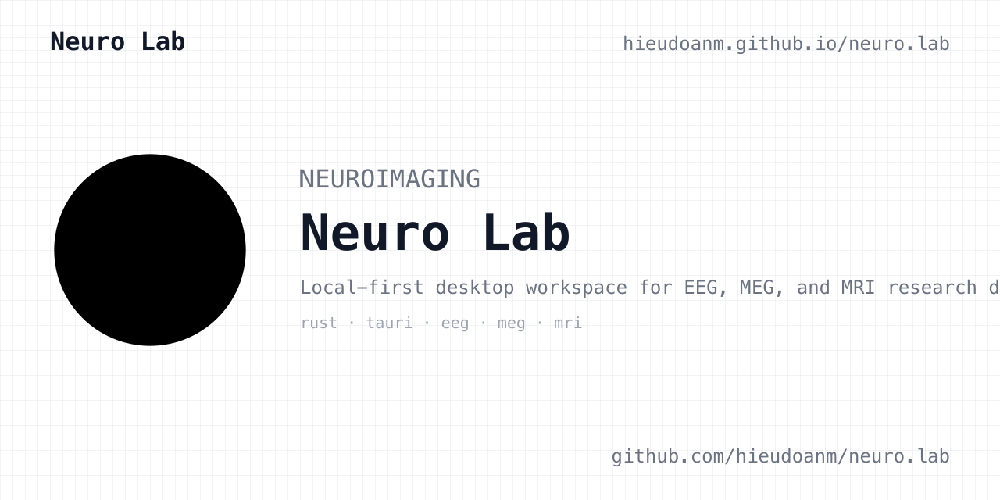

# neuro.lab

[](https://github.com/hieudoanm/neuro.lab/actions/workflows/ci.yaml?branch=master)  [](LICENSE)

Topics: `eeg`, `neuroimaging`, `meg`, `mri`, `tauri`, `rust`


Neuro Lab is a local-first desktop workspace for EEG, MEG, and MRI research data. It has no server dependency: the React interface runs inside Tauri and calls typed Rust commands directly. All computation and persistence stay on the local filesystem.



- Inspect, validate, and process EEG, MEG, and MRI recordings in one workspace.
- Reproducible JSON pipeline chains for filtering, artifact rejection, epoching, and more.
- Versioned datasets, experiments, analysis runs, and artifacts with provenance.
- `neuro` CLI for scripting: inspect, validate, convert, and export from the shell.
- Runs fully offline; data never leaves your machine.

## Table of Contents

- [neuro.lab](#neurolab)
  - [Table of Contents](#table-of-contents)
  - [Features](#features)
  - [Repository layout](#repository-layout)
  - [Command line](#command-line)
  - [Get Started](#get-started)
    - [Prerequisites](#prerequisites)
    - [Desktop app](#desktop-app)
    - [Checks](#checks)
  - [Landing site](#landing-site)
  - [License](#license)

## Features

- Local workspace with projects, experiments, datasets, versioned artifacts,
  provenance records, and resumable chunked uploads.
- Background analysis runs with progress reporting and cancellation.
- EEG: NPY/EDF/BrainVision input, EDF+ annotations and `.vmrk` markers as
  events, filtering, PSD, bad-channel detection, re-referencing
  (average/CAR/mastoid/median/robust/Laplacian), baseline correction,
  event-locked epoching with ERP, artifact rejection, FastICA.
- MEG: FIF/CTF/KIT/BIDS/OPM input, CTF compensation grades and FIF
  projectors/compensation applied to data, KIT trigger events and
  `.elp`/`.hsp` digitization sidecars, BIDS multi-run concatenation and
  per-run channel reconciliation, epoching/evoked responses, synthetic
  gradiometers, ICA artifact rejection, SSP, a documented low-order SSS
  approximation for gross interference rejection, and NPY/CSV/EDF/FIF/BIDS
  export (the FIF writer is validated against MNE).
- MRI: NIfTI and DICOM input (native 8/16-bit, multi-frame, RLE, JPEG
  baseline/extended, series directories), multiplanar slices, MIP,
  statistics, histogram, single operations and multi-step pipeline chains,
  bias-field correction, heuristic skull stripping, and rigid/affine
  registration with NCC or mutual-information metrics.
- Dataset search/sort, file-set validation, and artifact export.

## Repository layout

```text
crates/
  neuro-core/       Shared identifiers, provenance, checksums, run state
  neuro-eeg/        EEG readers (NPY, EDF+/EDF, BrainVision), pipelines
                    (filter, PSD, bad channels, re-reference, baseline,
                    epoching/ERP, ICA/FastICA with topographies,
                    SSP), EDF export
  neuro-meg/        MEG readers (FIF, CTF .ds, KIT .sqd/.con, BIDS, OPM),
                    compensation/projectors, events, pipelines
                    (filter, PSD, epoching/evoked, synthetic gradiometers,
                    ICA, SSP, low-order SSS), NPY/CSV/EDF/FIF/BIDS export
  neuro-mri/        NIfTI + DICOM input, slices, projections, statistics,
                    threshold/smooth/mask/segment/resample/z-score ops,
                    bias-field correction, heuristic skull stripping,
                    rigid/affine registration (NCC or mutual information)
  neuro-store/      Local workspace persistence: projects, datasets,
                    dataset versions, experiments, runs, artifacts,
                    upload sessions
  neuro-cli/        `neuro` command-line interface: inspect/validate EEG,
                    MEG, and MRI files, generate synthetic EEG, export EDF,
                    convert DICOM to NIfTI — JSON output for scripting
packages/desktop/   Tauri + React + TypeScript frontend
packages/landing/   Static landing page (no build step)
reference/          Imported source repositories retained for migration reference
```

## Command line

```bash
cargo install --path crates/neuro-cli   # or: cargo run -p neuro-cli -- <cmd>

neuro inspect-eeg recording.edf --pretty
neuro validate-meg /path/to/meg/ds
neuro convert-dicom scan.dcm -o volume.nii
neuro --help                            # all subcommands
```

Output is JSON on stdout; diagnostics go to stderr.

## Get Started

### Prerequisites

- Node.js (see `.nvmrc`) and pnpm
- Rust stable toolchain

### Desktop app

Prebuilt bundles are attached to the
[latest GitHub release](../../releases/latest):

```bash
scripts/install.sh        # download a release bundle, or build from source
```

Or from a local checkout:

```bash
pnpm install
pnpm tauri:dev            # development
pnpm tauri:build          # production bundles under target/release/bundle
```

### Checks

```bash
cargo fmt --all -- --check
cargo clippy --workspace --all-targets -- -D warnings
cargo test --workspace

pnpm typecheck            # from packages/desktop
pnpm lint
pnpm test
pnpm build
pnpm test:e2e
```

## Landing site

The static marketing site lives in `packages/landing` (no build step,
deployed to GitHub Pages): <https://hieudoanm.github.io/neuro.lab/>

## License

This project is licensed under the [MIT License](LICENSE).
