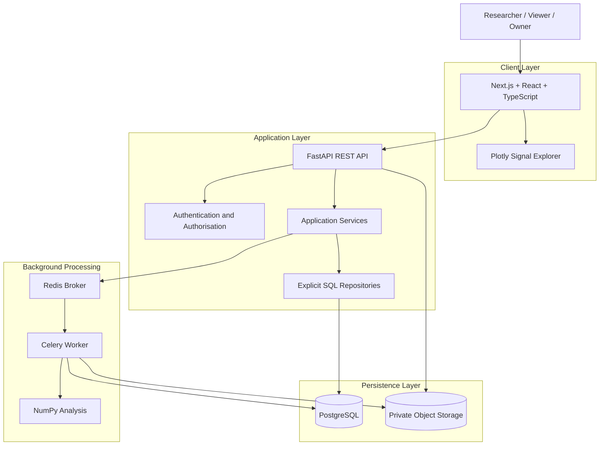
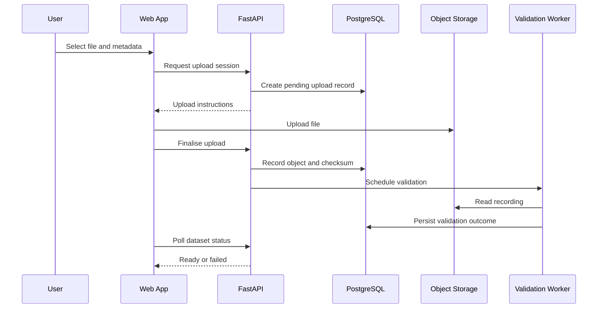

# EEG Lab — System Architecture

## 1. Purpose

This document describes the system architecture, component responsibilities, data flows, trust boundaries, and failure-recovery strategies for EEG Lab.

The architecture must support a secure neuroscience research workflow while remaining small enough for an independently developed portfolio project.

The primary architectural goals are:

- Clear separation of responsibilities.
- Strong organisation-level data isolation.
- Reliable asynchronous analysis.
- Reproducible scientific computation.
- Safe handling of large EEG recordings.
- Explicit and testable database access.
- Observable failures and recoverable operations.
- Reproducible local development and cloud deployment.

## 2. Architectural Overview

EEG Lab uses a modular monolith for its application API, with a separately deployed worker for background processing.

The frontend, API, worker, and supporting services have distinct responsibilities. The initial application should not be decomposed into many independent microservices.

### High-level architecture



The diagram shows logical responsibilities. The precise deployment topology may differ between local development and production.

The component architecture and detailed data-flow diagrams for system
boundaries, dataset upload, analysis processing, and CI/CD are indexed in
[`diagrams/`](diagrams/README.md).

## 3. Architectural Style

### 3.1 Modular monolith

The FastAPI service contains the application's business logic, API endpoints, and persistence integration.

Organise modules around responsibilities and domain concepts rather than creating a separate network service for every feature.

Advantages:

- Straightforward local development.
- Easier transaction management.
- Fewer deployment dependencies.
- Clearer debugging.
- Strong integration testing.
- Lower operational overhead.

### 3.2 Separate worker process

Background computation runs in a separate worker process.

This prevents expensive numerical operations from blocking the API event loop and allows the worker to have its own resource limits and scaling policy.

The worker shares domain and persistence modules with the API where appropriate, but it must not depend on API process memory.

### 3.3 Explicit boundaries

Keep the following boundaries clear:

- Presentation and client state.
- HTTP and API contracts.
- Application business rules.
- Persistence and SQL.
- Scientific computation.
- External infrastructure.

A module should not need to know the implementation details of unrelated layers.

## 4. Component Responsibilities

### 4.1 Frontend application

Technology: Next.js, React, TypeScript.

Responsibilities:

- Authentication experience.
- Organisation selection.
- Study management.
- Dataset upload.
- Metadata presentation.
- Signal exploration.
- Analysis submission.
- Job status monitoring.
- Result presentation.
- Accessible error and loading states.

The frontend is not trusted to enforce permissions or validate scientific data conclusively.

Browser code talks to the Python API only through the tRPC Backend-for-Frontend that runs inside the Next.js server (see `08-tech-stack.md` 4.5). The BFF reads the HttpOnly session cookie, resolves the active organisation on the server, and forwards authenticated REST requests; it never weakens the checks performed by the API.

Client-side validation improves usability, but the API must repeat all security-relevant checks.

### 4.2 API service

Technology: FastAPI and Pydantic.

Responsibilities:

- Authenticate requests.
- Resolve the current user.
- Verify organisation membership and permissions.
- Validate API input.
- Apply business rules.
- Manage relational metadata.
- Coordinate file uploads and finalisation.
- Create analysis jobs.
- Return bounded signal data.
- Retrieve analysis results.
- Emit structured logs.
- Expose health and readiness endpoints.

The API should remain stateless between requests, apart from appropriately managed external session mechanisms.

### 4.3 Application services

Application services implement complete business operations, such as:

- Creating a study.
- Finalising a dataset upload.
- Validating a recording.
- Submitting an analysis.
- Claiming or completing a job.
- Persisting an analysis result.

Services coordinate repositories and external integrations.

They should not contain presentation-specific logic or rely on implicit global state.

### 4.4 SQL repositories

Repositories encapsulate explicit SQL queries and transaction boundaries.

Responsibilities:

- Reading and writing domain records.
- Applying organisation-scoped filters.
- Handling concurrency.
- Enforcing expected state transitions.
- Retrieving paginated results.
- Mapping database rows to application structures.

Use parameterised SQL for all user-controlled values.

Repositories must not accept an organisation identifier from the client as proof of authorisation. They receive an organisation context already verified by the application layer.

### 4.5 Scientific processing module

Technology: Python and NumPy.

Responsibilities:

- Load or stream supported recording data within configured limits.
- Validate numerical arrays.
- Compute descriptive statistics.
- Return typed, serialisable results.
- Apply documented numerical conventions.
- Avoid modifying source data.

Keep numerical functions as deterministic and independently testable as practical.

### 4.6 Background worker

Technology: Celery.

Responsibilities:

- Execute queued analyses.
- Load authorised job inputs.
- Apply resource and time limits.
- Persist successful results.
- Record safe failure information.
- Retry eligible transient errors.
- Recover from interrupted execution.

A worker must verify the current job state before committing results. Receiving a duplicate message must not automatically mean the job can run again.

### 4.7 PostgreSQL

PostgreSQL is the source of truth for application metadata and job state.

It stores relational records, ownership relationships, lifecycle state, audit events, and analysis results.

### 4.8 Redis

Redis transports background task messages.

It is not the authoritative source of analysis job state. The application must be able to inspect job status from PostgreSQL even when Redis is temporarily unavailable.

### 4.9 Object storage

Private object storage holds EEG recordings and any large processing artefacts.

Store object keys and metadata in PostgreSQL. Do not store public URLs as a substitute for access control.

## 5. Repository and Module Boundaries

A suggested backend structure:

```text
packages/backend/app/
├── api/
│   ├── dependencies.py
│   ├── errors.py
│   ├── routes/
│   │   ├── auth.py
│   │   ├── organisations.py
│   │   ├── studies.py
│   │   ├── datasets.py
│   │   ├── signals.py
│   │   └── analyses.py
├── core/
│   ├── config.py
│   ├── logging.py
│   ├── security.py
│   └── exceptions.py
├── models/
│   ├── organisation.py
│   ├── study.py
│   ├── dataset.py
│   └── analysis.py
├── schemas/
│   ├── common.py
│   ├── study.py
│   ├── dataset.py
│   └── analysis.py
├── repositories/
│   ├── organisations.py
│   ├── studies.py
│   ├── datasets.py
│   └── analyses.py
├── services/
│   ├── studies.py
│   ├── uploads.py
│   ├── validation.py
│   ├── signals.py
│   └── analyses.py
├── scientific/
│   ├── recording.py
│   └── statistics.py
├── storage/
│   └── objects.py
├── workers/
│   ├── celery_app.py
│   └── analysis_tasks.py
└── main.py
```

This is a proposed organisation. Keep the codebase simpler if a module does not yet justify its own file.

Avoid circular imports and avoid importing API route handlers into business logic.

## 6. Request Lifecycle

For a protected API request:

Browser-originated requests first reach the Next.js tRPC Backend-for-Frontend, which authenticates the caller from the HttpOnly session cookie and resolves the organisation context before forwarding a REST request to the Python API. The steps below describe the Python API that ultimately serves the data.

1. The frontend sends an HTTP request.
2. The API validates the request format.
3. Authentication identifies the caller.
4. The application resolves the relevant organisation context.
5. The server verifies membership and role permissions.
6. The application service executes the requested operation.
7. Repositories perform parameterised SQL operations as required.
8. External services are called only when needed.
9. The API constructs an explicit response model.
10. Structured logs capture the outcome and request identifier.

For state-changing requests, database transactions must protect the relevant invariants.

Authentication, organisation scope, and resource ownership should be checked before returning protected data or starting expensive work.

## 7. Organisation Isolation

Organisation isolation is a fundamental security boundary.

### 7.1 Trusted identity

The server obtains the user identity from the verified authentication mechanism.

It must not trust a client-supplied user ID as proof of identity.

### 7.2 Membership verification

Before accessing an organisation-scoped resource, the server verifies that the authenticated user has an appropriate membership.

### 7.3 Resource scoping

For a dataset belonging to a study, the application must verify the relationship between:

- Authenticated user.
- Organisation membership.
- Study.
- Dataset.
- Requested operation.

Checking only that the dataset ID exists is insufficient.

### 7.4 Defence in depth

Use:

- Server-side authorisation.
- Explicit organisation-scoped queries.
- Database constraints.
- Tests using multiple organisations.
- Carefully controlled service credentials.
- Optional database row-level security if implemented and tested correctly.

### 7.5 Cache isolation

Organisation-specific caches must be keyed by the appropriate organisation and user context.

When the active organisation changes, the frontend must invalidate relevant cached data.

A cache hit must never bypass a permission check that is required for the operation.

## 8. Dataset Upload Architecture

Large files should not routinely pass through several layers of application memory.

### Recommended flow



This sequence is conceptual. The initial implementation may perform validation synchronously if the file limits make that safe, but large or expensive validation should use the worker.

### Upload invariants

- The user must be authorised to upload into the target study.
- Storage is private.
- The server validates the file independently of browser checks.
- The dataset is not ready before validation succeeds.
- Finalisation must be idempotent or protected against duplicate requests.
- Interrupted uploads can be identified and cleaned up.
- A database failure after object upload must not create an indefinitely invisible object.
- Upload sessions and signed URLs must expire.
- File size and parser limits must be enforced.

### Upload recovery

Use an explicit lifecycle and reconciliation process.

For example, an object may exist while the database still records a pending upload. A scheduled cleanup or reconciliation task should detect abandoned records and unreferenced objects according to a documented retention policy.

Do not delete source files merely because a transient database operation failed.

## 9. Signal Retrieval Architecture

The frontend requests a bounded recording interval.

Example request:

```http
GET /api/v1/organisations/{organisation_id}/datasets/{dataset_id}/signals?start_seconds=10&end_seconds=15&channels=0,1
```

The API should:

1. Authenticate the request.
2. Verify organisation and dataset access.
3. Verify that the dataset is ready.
4. Validate the time interval and channel selection.
5. Enforce maximum request and response sizes.
6. Read only the required portion when supported by the chosen file representation.
7. Apply documented display downsampling if necessary.
8. Return the signal samples and corresponding time axis.
9. Include metadata that explains the response representation.

### Performance considerations

A basic `.npy` file is not automatically an efficient format for every partial-read workload.

If the selected format requires loading a large file for each interval, use memory mapping where supported, bounded caching, or a later storage-format change. Do not allow arbitrary interval requests to exhaust worker or API memory.

The API should avoid sending an entire recording to the browser simply because the user opened the explorer.

## 10. Analysis Job Architecture

### 10.1 Job submission

The API validates the request and creates a durable job record.

The record includes:

- Job ID.
- Organisation ID.
- Dataset ID and version.
- Analysis type.
- Validated parameters.
- Requested-by user ID.
- Idempotency information where applicable.
- Current state.
- Timestamps.

The API returns the job resource without waiting for the analysis to finish.

### 10.2 Dispatch reliability

A naive sequence of committing a job to PostgreSQL and then publishing a Redis message has a failure window: the database transaction may succeed while queue publication fails.

Use a transactional outbox or another explicitly documented reliable-dispatch mechanism.

With an outbox:

1. Create the job and outbox event in the same database transaction.
2. Commit both.
3. A dispatcher publishes pending outbox events.
4. The dispatcher marks an event as published after successful delivery.
5. Repeated publication remains safe because worker processing is idempotent.

### 10.3 Worker execution

The worker:

1. Receives a job identifier.
2. Loads the job from PostgreSQL.
3. Checks that its state permits execution.
4. Claims the job using a concurrency-safe transition.
5. Loads the relevant dataset and metadata.
6. Executes the validated analysis.
7. Validates the output.
8. Persists the result.
9. Marks the job successful in the appropriate transaction.
10. Emits structured operational logs.

If a failure occurs, the worker records an appropriate state and classifies whether retry is safe.

### 10.4 Concurrency

Do not allow multiple workers to commit competing results for the same logical job.

Use a conditional state update, row locking, a lease, or another explicitly tested concurrency mechanism.

A worker that discovers the job has already completed should exit without changing its result.

### 10.5 Retries

Use bounded retries with exponential backoff and jitter for transient failures.

Do not automatically retry invalid input, unsupported file formats, or deterministic scientific computation errors without a clear reason.

Define what happens when the retry limit is reached.

### 10.6 Stale jobs

Implement a recovery strategy for jobs left in `running` after a worker crash.

A lease or heartbeat can distinguish active processing from stale ownership.

Recovery must avoid restarting work that is still executing elsewhere.

## 11. Result Persistence and Reproducibility

An analysis result must be linked to the exact input and computation that produced it.

Record:

- Source dataset and version.
- Source checksum or stable content identifier.
- Analysis type.
- Algorithm version.
- Parameters.
- Result schema version.
- Execution timestamps.
- Relevant software version.

Persist the result and successful terminal job state consistently.

If result persistence fails, the job must not appear successful.

If a result artefact is stored in object storage, account for the lack of a shared transaction between PostgreSQL and object storage. Use a staged write and finalisation process, or another documented recovery mechanism.

Historical results should not be silently overwritten by later runs.

## 12. API and Worker Separation

The API and worker share domain logic and persistence modules, but run as separate processes.

### API process

Optimise for:

- Request latency.
- Network I/O.
- Bounded database access.
- Predictable concurrency.
- Fast validation.

### Worker process

Optimise for:

- CPU and memory limits.
- Numerical computation.
- Long-running operations.
- Retry and recovery behaviour.
- Processing throughput.

Do not start a Celery worker inside the FastAPI process or rely on background tasks that disappear when the API process restarts for work that must be durable.

## 13. Database Transactions and Integrity

Use PostgreSQL transactions for operations that must be atomic within the relational database.

Examples:

- Creating a study and related initial records.
- Creating a job and its outbox event.
- Persisting a result and marking the job successful.
- Updating membership and recording the corresponding audit event.

Use constraints for invariants that should remain true regardless of which application code path performs a write.

Do not assume that a successful object-storage operation can be rolled back by a PostgreSQL transaction.

Use compensating operations and reconciliation where multiple services participate in a workflow.

## 14. Authentication Architecture

The authentication implementation must be chosen and documented before production deployment.

Acceptable approaches include:

- A managed OpenID Connect provider.
- A carefully implemented server-side session system.
- Another maintained authentication solution with clear security properties.

Do not build a custom password-management system merely to avoid selecting an authentication provider.

The architecture must document:

- Identity verification.
- Session lifecycle.
- Cookie or token storage.
- CSRF protection where applicable.
- CORS configuration.
- Logout behaviour.
- Membership revocation.
- Local development authentication.
- Production identity configuration.

Prefer secure, HttpOnly cookies for browser sessions when the chosen authentication architecture supports them appropriately.

Never store long-lived credentials in browser local storage.

## 15. External Service Boundaries

Wrap external integrations behind small interfaces where this improves testability.

Examples:

- `ObjectStorage`: upload, read, inspect, and delete objects.
- `AnalysisDispatcher`: publish or schedule a durable job.
- `AuthenticationProvider`: validate identity or resolve session.
- `Clock`: provide deterministic time in tests where useful.

Do not introduce a generic plugin framework or extensive dependency-injection system without a concrete need.

The goal is to make infrastructure replaceable and testable without hiding the important application behaviour.

## 16. Observability

### Structured logs

Include fields such as:

- Timestamp.
- Severity.
- Service name.
- Request or job ID.
- Operation.
- Outcome.
- Error classification.
- Duration.
- Organisation identifier where safe.

### Metrics

Track useful operational measurements:

- Request latency.
- API error rate.
- Database connection utilisation.
- Upload failures.
- Queue depth.
- Job execution duration.
- Job retry count.
- Job failure rate.
- Stale job count.

### Correlation

A job should retain enough context to correlate its API submission, dispatch, worker execution, and result persistence.

Do not put secrets, access tokens, signed URLs, or raw EEG payloads in logs.

## 17. Deployment Architecture

### Local development

Use Docker Compose for PostgreSQL, Redis, and any supporting local services.

Run the frontend, API, and worker using documented commands or containers.

The development setup should not require access to production credentials.

### Production

A practical initial deployment may use:

- Next.js hosted through a suitable managed web platform.
- FastAPI deployed as a managed container.
- A separate worker deployment.
- Managed PostgreSQL.
- Private object storage.
- A compatible managed Redis broker.
- Managed secrets and logging.

Terraform should define the required infrastructure and access policies.

The chosen services must support the connection, networking, worker, and durability requirements of the application.

## 18. Failure Scenarios

| Failure                           | Expected behaviour                                                              |
| --------------------------------- | ------------------------------------------------------------------------------- |
| PostgreSQL unavailable            | Requests requiring database access fail safely; readiness reports unavailable   |
| Redis unavailable                 | Job dispatch is delayed or retried; accepted jobs remain visible in PostgreSQL  |
| Worker crashes                    | Job recovery identifies stale execution and safely retries eligible work        |
| Object storage unavailable        | Upload or retrieval fails clearly; metadata remains consistent                  |
| Upload interrupted                | Upload remains incomplete and can be retried or cleaned up                      |
| Result write fails                | Job is not marked successful                                                    |
| Duplicate task delivered          | Worker state checks prevent conflicting duplicate results                       |
| Session expires                   | User is asked to re-authenticate or renew the session                           |
| Organisation membership revoked   | Protected operations are denied after revocation takes effect                   |
| Frontend request becomes obsolete | Cancellation or request identity prevents stale results replacing current state |

## 19. Security Boundaries

Treat these as separate trust zones:

1. Browser and client-controlled state.
2. Authenticated API.
3. Relational database.
4. Object storage.
5. Message broker.
6. Background worker.
7. Cloud control plane.

Security requirements:

- Validate all external input.
- Authenticate before protected access.
- Authorise each resource operation.
- Use least-privilege service identities.
- Restrict network access to internal services.
- Use TLS for external service communication.
- Protect secrets and signing credentials.
- Bound CPU, memory, file sizes, and execution time.
- Keep uploaded files non-executable.
- Never execute uploaded code.
- Avoid leaking data through logs, error responses, caches, or object URLs.

## 20. Architecture Decision Records

Document significant decisions under `docs/decisions/`.

At minimum:

- Authentication provider and session model.
- EEG file format and partial-read strategy.
- Job dispatch and transactional outbox.
- Explicit SQL and repository boundaries.
- Object-storage upload lifecycle.
- Worker hosting and Redis compatibility.
- Organisation isolation strategy.
- Deployment topology.

Each record should state the context, decision, alternatives, consequences, and criteria for reconsideration.

## 21. Architecture Definition of Done

The architecture is implemented when:

1. The API and worker run independently.
2. The application has explicit module boundaries.
3. Tenant isolation is enforced and tested.
4. PostgreSQL is authoritative for jobs and results.
5. Background task dispatch has a documented reliability strategy.
6. Duplicate task delivery cannot corrupt results.
7. The repository's Husky pre-commit hook runs lint-staged on staged backend and frontend source; CI remains the full validation authority.
8. Large recordings are handled within configured resource limits.
9. Source data and result provenance are preserved.
10. Cross-service failure recovery is documented and tested.
11. Structured logging supports investigation.
12. Secrets and private recordings are protected.
13. Local development and deployment follow documented architecture.
