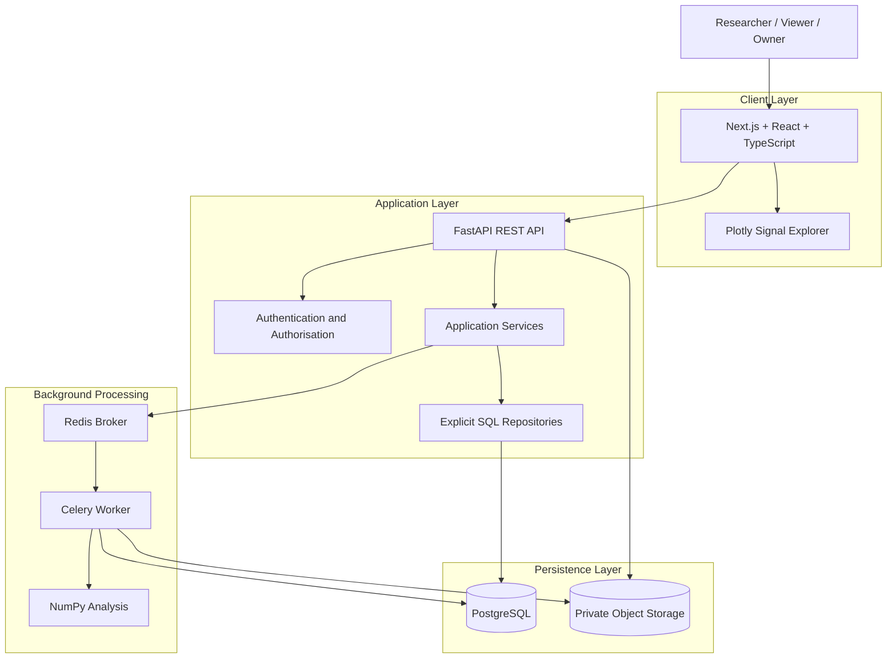

## 2. Architectural Overview

EEG Lab uses a modular monolith for its application API, with a separately deployed worker for background processing.

The frontend, API, worker, and supporting services have distinct responsibilities. The initial application should not be decomposed into many independent microservices.

### High-level architecture

The diagram shows logical responsibilities. The precise deployment topology may differ between local development and production.

The component architecture and detailed data-flow diagrams for system
boundaries, dataset upload, analysis processing, and CI/CD are indexed in
[`diagrams/`](diagrams/README.md).

