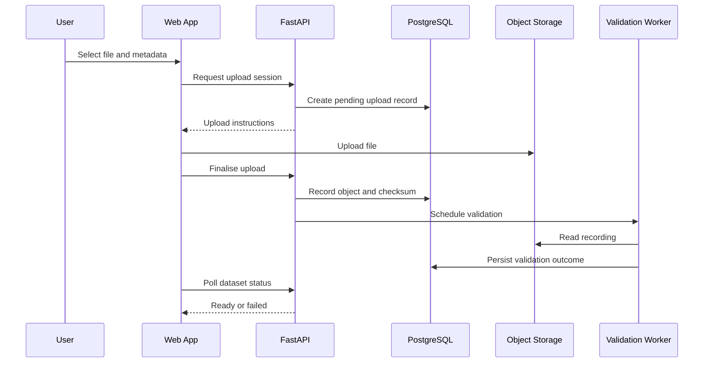

## 8. Dataset Upload Architecture

Large files should not routinely pass through several layers of application memory.

### Recommended flow

This sequence is conceptual. The initial implementation may perform validation synchronously if the file limits make that safe, but large or expensive validation should use the worker.

### Upload invariants

- The user must be authorised to upload into the target study.
- Storage is private.
- The server validates the file independently of browser checks.
- The dataset is not ready before validation succeeds.
- Finalisation must be idempotent or protected against duplicate requests.
- Interrupted uploads can be identified and cleaned up.
- A database failure after object upload must not create an indefinitely invisible object.
- Upload sessions and signed URLs must expire.
- File size and parser limits must be enforced.

### Upload recovery

Use an explicit lifecycle and reconciliation process.

For example, an object may exist while the database still records a pending upload. A scheduled cleanup or reconciliation task should detect abandoned records and unreferenced objects according to a documented retention policy.

Do not delete source files merely because a transient database operation failed.

