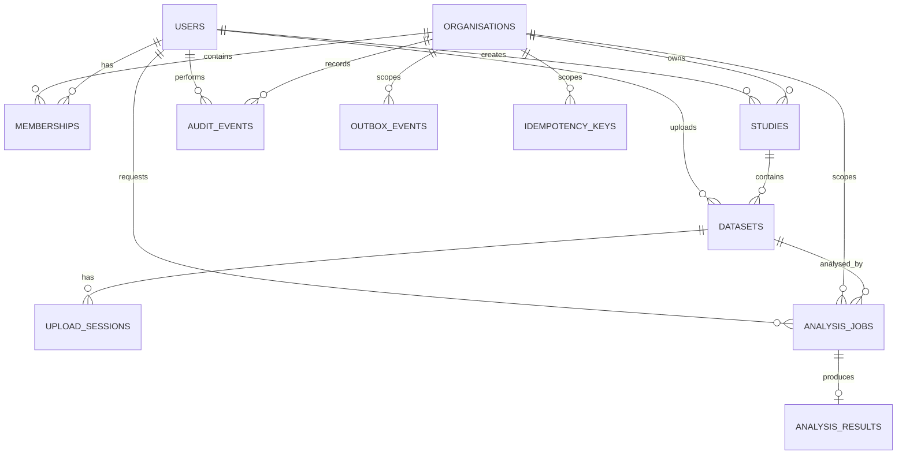

# EEG Lab — Data Model and Database Schema

## 1. Purpose

This document defines EEG Lab's relational data model, entity relationships, PostgreSQL constraints, indexes, lifecycle rules, and data integrity requirements.

The data model must support:

- Multi-tenant research organisations.
- User membership and role-based access.
- Studies and EEG datasets.
- Dataset upload and validation.
- Asynchronous analysis jobs.
- Reproducible analysis results.
- Audit events.
- Idempotent operations.
- Reliable background-job dispatch.

PostgreSQL is the authoritative source for application metadata, job state, and persisted analysis results. Large scientific recordings are stored in private object storage.

## 2. Data Modelling Principles

1. Every tenant-owned resource must have an explicit organisation scope.
2. Use UUID primary keys for externally addressable resources.
3. Use foreign keys to enforce relational integrity.
4. Use database constraints for important invariants.
5. Use UTC timestamps for persisted event times.
6. Store scientific metadata explicitly rather than relying on filenames.
7. Keep source recordings immutable after successful registration.
8. Version analysis algorithms and result schemas.
9. Preserve provenance for completed analyses.
10. Avoid storing secrets or unnecessary sensitive information.
11. Prefer explicit SQL and reviewed migrations.
12. Never rely solely on frontend validation for data integrity.

## 3. Entity Overview

The initial schema contains these principal entities:

| Entity             | Purpose                                               |
| ------------------ | ----------------------------------------------------- |
| `users`            | Application user identities                           |
| `organisations`    | Research workspaces and tenant boundaries             |
| `memberships`      | User roles within organisations                       |
| `studies`          | Research projects within an organisation              |
| `datasets`         | Recording metadata and object-storage references      |
| `upload_sessions`  | Upload lifecycle and finalisation state               |
| `analysis_jobs`    | Durable asynchronous job state                        |
| `analysis_results` | Persisted scientific output and provenance            |
| `outbox_events`    | Reliable dispatch of background work                  |
| `idempotency_keys` | Duplicate-request protection                          |
| `audit_events`     | Security-relevant and operationally important actions |

An authentication provider may own the authoritative identity record. The local `users` table should map to that identity rather than duplicate credentials unnecessarily.

## 4. Entity Relationship Diagram



Some supporting relationships, such as references to a dataset version, may be implemented as additional columns or tables as the product evolves.

The current PostgreSQL schema is also available as a DBML diagram source at
[`database/eeg-lab.dbml`](database/eeg-lab.dbml). It reflects the versioned SQL
migrations under `packages/backend/migrations/versions/`.

## 5. Common Column Conventions

### Identifiers

Use PostgreSQL UUID columns for primary keys.

Generate identifiers in the application or through PostgreSQL's supported UUID generation functions. Use one consistent approach.

### Timestamps

Use `TIMESTAMPTZ` for timestamps.

Common fields:

- `created_at`
- `updated_at`
- `completed_at`
- `archived_at`

Use UTC for application-level timestamp handling and return ISO 8601 timestamps through the API.

### Statuses

Represent lifecycle states using constrained text values or PostgreSQL enums.

For an evolving MVP, `TEXT` plus `CHECK` constraints can be easier to migrate than frequently changing enum types. Apply the same approach consistently.

### JSONB

Use `JSONB` for structured, validated metadata when its shape genuinely varies.

Do not use unrestricted JSONB as a substitute for relational modelling of core ownership, identity, status, or frequently queried relationships.

### Deletion

Prefer archival or explicit lifecycle transitions for scientific resources.

Avoid cascading deletion from an organisation or study into irreplaceable scientific data unless permanent deletion is an explicit, authorised, and auditable workflow.

## 6. `users`

Represents an application user.

Suggested columns:

| Column              | Type                  | Constraints / purpose            |
| ------------------- | --------------------- | -------------------------------- |
| `id`                | UUID                  | Primary key                      |
| `identity_provider` | TEXT                  | External identity provider       |
| `external_subject`  | TEXT                  | Stable identity-provider subject |
| `email`             | TEXT, nullable        | Contact/display information      |
| `display_name`      | TEXT, nullable        | User-facing name                 |
| `created_at`        | TIMESTAMPTZ           | Creation time                    |
| `updated_at`        | TIMESTAMPTZ           | Last update time                 |
| `disabled_at`       | TIMESTAMPTZ, nullable | Optional account disablement     |

Constraints:

- Unique identity on `(identity_provider, external_subject)`.
- Do not use email as the sole permanent identity key.
- Normalise email consistently if it is used for lookup.
- Do not store passwords when authentication is delegated to an external provider.

A local-development identity mechanism must be isolated from production authentication.

## 7. `organisations`

Represents an organisation or research workspace.

Suggested columns:

| Column       | Type        | Constraints / purpose              |
| ------------ | ----------- | ---------------------------------- |
| `id`         | UUID        | Primary key                        |
| `name`       | TEXT        | Required, non-empty                |
| `slug`       | TEXT        | Optional human-readable identifier |
| `status`     | TEXT        | Active or archived                 |
| `created_at` | TIMESTAMPTZ | Creation time                      |
| `updated_at` | TIMESTAMPTZ | Last update time                   |

Constraints:

- Name must not be blank.
- Status must use a supported value.
- If a slug is used, define whether uniqueness is global or organisation-specific. A globally unique slug is the simpler initial choice.

Do not rely on the slug as a security boundary.

## 8. `memberships`

Associates a user with an organisation and defines their role.

Suggested columns:

| Column            | Type        | Constraints / purpose              |
| ----------------- | ----------- | ---------------------------------- |
| `id`              | UUID        | Primary key                        |
| `organisation_id` | UUID        | Foreign key                        |
| `user_id`         | UUID        | Foreign key                        |
| `role`            | TEXT        | `owner`, `researcher`, or `viewer` |
| `created_at`      | TIMESTAMPTZ | Membership creation                |
| `updated_at`      | TIMESTAMPTZ | Last role update                   |

Constraints:

- Unique `(organisation_id, user_id)`.
- Role must be one of the supported values.
- Both foreign keys must reference existing records.

The last-owner invariant requires transactional application logic or another explicitly enforced mechanism. A simple role check constraint cannot ensure that an organisation always has an owner.

Role changes and membership removals must generate audit events.

## 9. `studies`

Represents a research study.

Suggested columns:

| Column            | Type                  | Constraints / purpose      |
| ----------------- | --------------------- | -------------------------- |
| `id`              | UUID                  | Primary key                |
| `organisation_id` | UUID                  | Owning organisation        |
| `name`            | TEXT                  | Required, non-empty        |
| `description`     | TEXT, nullable        | Optional description       |
| `status`          | TEXT                  | `active` or `archived`     |
| `created_by`      | UUID                  | User who created the study |
| `created_at`      | TIMESTAMPTZ           | Creation time              |
| `updated_at`      | TIMESTAMPTZ           | Last update                |
| `archived_at`     | TIMESTAMPTZ, nullable | Archive timestamp          |

Constraints:

- Name must not be blank.
- Status must be supported.
- Organisation foreign key is required.
- Creator must reference a valid user.

A study name does not need to be globally unique. Multiple organisations may use the same name, and one organisation may have several similarly named studies.

### Indexes

- `(organisation_id, created_at DESC)`
- `(organisation_id, status, updated_at DESC)`

Add search indexes only when required by the implemented search behaviour.

## 10. `datasets`

Represents a registered recording and its metadata.

Suggested columns:

| Column                  | Type                       | Constraints / purpose                      |
| ----------------------- | -------------------------- | ------------------------------------------ |
| `id`                    | UUID                       | Primary key                                |
| `organisation_id`       | UUID                       | Tenant scope                               |
| `study_id`              | UUID                       | Parent study                               |
| `name`                  | TEXT                       | User-facing dataset name                   |
| `description`           | TEXT, nullable             | Optional description                       |
| `status`                | TEXT                       | Upload and validation lifecycle            |
| `format`                | TEXT                       | Supported recording format                 |
| `storage_key`           | TEXT, nullable             | Private object key                         |
| `object_version`        | TEXT, nullable             | Object version or generation, if supported |
| `checksum_sha256`       | TEXT, nullable             | Content integrity hash                     |
| `file_size_bytes`       | BIGINT, nullable           | Source size                                |
| `sampling_frequency_hz` | DOUBLE PRECISION, nullable | Sampling frequency                         |
| `channel_count`         | INTEGER, nullable          | Number of channels                         |
| `sample_count`          | BIGINT, nullable           | Samples per channel                        |
| `duration_seconds`      | DOUBLE PRECISION, nullable | Recording duration                         |
| `channel_names`         | JSONB, nullable            | Ordered channel labels                     |
| `channel_units`         | JSONB, nullable            | Units or unit metadata                     |
| `metadata`              | JSONB                      | Validated supplementary metadata           |
| `source_description`    | TEXT, nullable             | Provenance description                     |
| `uploaded_by`           | UUID                       | Uploading user                             |
| `created_at`            | TIMESTAMPTZ                | Creation time                              |
| `updated_at`            | TIMESTAMPTZ                | Last update                                |
| `validated_at`          | TIMESTAMPTZ, nullable      | Successful validation time                 |
| `archived_at`           | TIMESTAMPTZ, nullable      | Optional archive time                      |

Suggested states:

- `pending_upload`
- `validating`
- `ready`
- `rejected`
- `failed`
- `archived`

Constraints:

- Dataset name must not be blank.
- File size must be non-negative when present.
- Sampling frequency must be positive when present.
- Channel count must be positive when present.
- Sample count must be non-negative when present.
- Duration must be non-negative when present.
- Checksum must match the documented SHA-256 representation when present.
- `ready` requires valid recording metadata and a registered source object.
- The parent study must belong to the same organisation.
- The uploading user must be a valid user.

### Composite tenant constraints

To reduce the risk of inconsistent cross-organisation relationships, create a unique key on `(organisation_id, id)` and use composite foreign keys where appropriate.

For example, a dataset should reference its parent study through both `organisation_id` and `study_id`, not merely through `study_id`.

This makes it harder to accidentally associate a dataset with a study from another organisation.

### Indexes

- `(organisation_id, study_id, created_at DESC)`
- `(organisation_id, status, updated_at DESC)`
- Unique or supporting index on a stable dataset identifier where required.

Avoid indexing every metadata field by default.

## 11. `upload_sessions`

Tracks upload attempts and finalisation.

Suggested columns:

| Column                     | Type                  | Constraints / purpose                   |
| -------------------------- | --------------------- | --------------------------------------- |
| `id`                       | UUID                  | Primary key                             |
| `organisation_id`          | UUID                  | Tenant scope                            |
| `dataset_id`               | UUID                  | Associated dataset                      |
| `created_by`               | UUID                  | Initiating user                         |
| `status`                   | TEXT                  | Upload lifecycle                        |
| `object_key`               | TEXT, nullable        | Server-generated storage key            |
| `manifest`                 | JSONB                 | Channel/sampling manifest, default `{}` |
| `expected_size_bytes`      | BIGINT, nullable      | Expected upload size                    |
| `expected_checksum_sha256` | TEXT, nullable        | Expected checksum                       |
| `expires_at`               | TIMESTAMPTZ           | Expiry                                  |
| `finalised_at`             | TIMESTAMPTZ, nullable | Finalisation time                       |
| `created_at`               | TIMESTAMPTZ           | Creation time                           |
| `updated_at`               | TIMESTAMPTZ           | Last update                             |

Suggested states:

- `created`
- `uploading`
- `uploaded`
- `finalising`
- `completed`
- `failed`
- `expired`

Constraints and rules:

- Upload sessions are scoped to an organisation.
- `manifest` stores the validated channel/sampling metadata supplied at session creation; it is copied to the dataset only after successful validation.
- Expired sessions cannot be finalised as new uploads.
- Finalisation must be idempotent.
- Temporary upload authorisations must expire.
- Abandoned sessions must be discoverable for cleanup.
- Never store a signed URL as a permanent storage reference.

When a session fails validation, the session transitions to `failed` and the associated dataset to `rejected`; only a successful finalisation writes recording metadata and `validated_at` onto the dataset.

## 12. `analysis_jobs`

Represents a requested scientific computation.

Suggested columns:

| Column              | Type                  | Constraints / purpose         |
| ------------------- | --------------------- | ----------------------------- |
| `id`                | UUID                  | Primary key                   |
| `organisation_id`   | UUID                  | Tenant scope                  |
| `dataset_id`        | UUID                  | Source dataset                |
| `requested_by`      | UUID                  | Requesting user               |
| `analysis_type`     | TEXT                  | Supported analysis identifier |
| `algorithm_version` | TEXT                  | Algorithm version             |
| `parameters`        | JSONB                 | Validated analysis parameters |
| `status`            | TEXT                  | Job lifecycle                 |
| `attempt_count`     | INTEGER               | Number of execution attempts  |
| `max_attempts`      | INTEGER               | Retry limit                   |
| `error_code`        | TEXT, nullable        | Safe error classification     |
| `error_message`     | TEXT, nullable        | Sanitised diagnostic message  |
| `idempotency_key`   | TEXT, nullable        | Request deduplication key     |
| `requested_at`      | TIMESTAMPTZ           | Submission time               |
| `started_at`        | TIMESTAMPTZ, nullable | Execution start               |
| `completed_at`      | TIMESTAMPTZ, nullable | Terminal time                 |
| `lease_expires_at`  | TIMESTAMPTZ, nullable | Optional worker lease         |
| `created_at`        | TIMESTAMPTZ           | Record creation               |
| `updated_at`        | TIMESTAMPTZ           | Last update                   |

Suggested states:

- `queued`
- `running`
- `succeeded`
- `failed`
- `cancelled`

Constraints:

- Dataset and job must belong to the same organisation.
- Attempt counts must be non-negative.
- `max_attempts` must be positive.
- Analysis type must be supported.
- Parameters must pass schema validation before submission.
- Terminal states must not transition back to `running` without creating a new execution according to the documented retry model.
- `completed_at` must be populated when a terminal state is reached.
- The dataset version and analysis configuration used by a successful job must remain identifiable.

### Idempotency design

A job's idempotency scope should be explicit. A suitable initial scope is the authenticated user and organisation, combined with an endpoint or operation identifier and an idempotency key.

Do not assume that the same parameters always mean the same user intent. Two intentionally separate analysis runs may use identical parameters.

### Indexes

- `(organisation_id, requested_at DESC)`
- `(organisation_id, status, requested_at DESC)`
- `(organisation_id, dataset_id, requested_at DESC)`
- Index on `lease_expires_at` for stale-job recovery if leases are implemented.

## 13. `analysis_results`

Stores the output of a completed analysis.

Suggested columns:

| Column                    | Type           | Constraints / purpose       |
| ------------------------- | -------------- | --------------------------- |
| `id`                      | UUID           | Primary key                 |
| `organisation_id`         | UUID           | Tenant scope                |
| `job_id`                  | UUID           | Source analysis job         |
| `dataset_id`              | UUID           | Source dataset              |
| `dataset_checksum_sha256` | TEXT, nullable | Input content identifier    |
| `algorithm_version`       | TEXT           | Computation version         |
| `result_schema_version`   | TEXT           | Result structure version    |
| `results`                 | JSONB          | Validated numerical output  |
| `provenance`              | JSONB          | Relevant execution metadata |
| `created_at`              | TIMESTAMPTZ    | Persistence time            |

Constraints:

- Each job produces at most one canonical result for the initial analysis model.
- `job_id` is unique.
- Result, job, dataset, and organisation relationships must be consistent.
- Results may only be committed as successful output after validation.
- Result schema and algorithm versions are required.

If a later analysis produces multiple artefacts, use a dedicated result-artefact table rather than overloading one JSON field with unrelated storage concerns.

### Result representation

For the initial descriptive analysis, a JSON structure may contain one entry per channel with:

- Channel index.
- Channel name.
- Mean.
- Standard deviation.
- Minimum.
- Maximum.
- Peak-to-peak range.
- Valid sample count.
- Unit where known.

Validate the result structure before persistence.

### Indexes

- Unique `(job_id)`.
- `(organisation_id, dataset_id, created_at DESC)`.

## 14. `outbox_events`

Supports reliable publication of background work.

Suggested columns:

| Column            | Type                  | Constraints / purpose              |
| ----------------- | --------------------- | ---------------------------------- |
| `id`              | UUID                  | Primary key                        |
| `organisation_id` | UUID, nullable        | Tenant context where applicable    |
| `event_type`      | TEXT                  | Event name                         |
| `aggregate_type`  | TEXT                  | Related resource type              |
| `aggregate_id`    | UUID                  | Related resource identifier        |
| `payload`         | JSONB                 | Minimal validated dispatch payload |
| `created_at`      | TIMESTAMPTZ           | Creation time                      |
| `published_at`    | TIMESTAMPTZ, nullable | Publication time                   |
| `attempt_count`   | INTEGER               | Dispatch attempts                  |
| `next_attempt_at` | TIMESTAMPTZ, nullable | Scheduled retry                    |
| `last_error_code` | TEXT, nullable        | Safe failure classification        |

Constraints:

- Payload must not contain secrets or raw scientific arrays.
- Published events must not be republished indefinitely.
- Dispatch retries must be bounded or moved to an operationally visible failure state.
- Duplicate delivery must be safe.

A dispatcher may use row locking with `FOR UPDATE SKIP LOCKED` to claim events without multiple dispatchers continuously processing the same rows.

## 15. `idempotency_keys`

Provides a durable record of state-changing API requests that require deduplication.

Suggested columns:

| Column            | Type              | Constraints / purpose              |
| ----------------- | ----------------- | ---------------------------------- |
| `id`              | UUID              | Primary key                        |
| `organisation_id` | UUID              | Tenant scope                       |
| `user_id`         | UUID              | Requesting user                    |
| `operation`       | TEXT              | API operation identifier           |
| `key`             | TEXT              | Client-provided idempotency key    |
| `request_hash`    | TEXT              | Hash of canonicalised request data |
| `response_status` | INTEGER, nullable | Recorded response status           |
| `response_body`   | JSONB, nullable   | Safe response representation       |
| `resource_id`     | UUID, nullable    | Created resource identifier        |
| `created_at`      | TIMESTAMPTZ       | First request time                 |
| `expires_at`      | TIMESTAMPTZ       | Retention deadline                 |

Constraints:

- Unique `(organisation_id, user_id, operation, key)`.
- Reuse with a different request hash must be rejected.
- Concurrent requests using the same key must not create duplicate logical operations.
- Sensitive response fields must not be stored.
- Retention and cleanup behaviour must be documented.

Use idempotency records for operations where duplicate execution would be harmful or confusing, especially analysis submission and upload finalisation.

## 16. `audit_events`

Stores an append-oriented history of important actions.

Suggested columns:

| Column            | Type           | Constraints / purpose               |
| ----------------- | -------------- | ----------------------------------- |
| `id`              | UUID           | Primary key                         |
| `organisation_id` | UUID, nullable | Organisation context                |
| `actor_user_id`   | UUID, nullable | Acting user                         |
| `action`          | TEXT           | Event action                        |
| `resource_type`   | TEXT           | Affected resource type              |
| `resource_id`     | UUID, nullable | Affected resource                   |
| `request_id`      | TEXT, nullable | Correlation identifier              |
| `metadata`        | JSONB          | Minimal non-sensitive event details |
| `created_at`      | TIMESTAMPTZ    | Event time                          |

Example actions:

- `study.created`
- `study.updated`
- `study.archived`
- `dataset.uploaded`
- `dataset.validation_failed`
- `analysis.submitted`
- `analysis.completed`
- `analysis.failed`
- `membership.role_changed`
- `membership.removed`

Rules:

- Audit records should be append-only through normal application workflows.
- Public application endpoints must not allow arbitrary modification of audit history.
- Record only necessary metadata.
- Do not store tokens, passwords, signed URLs, or raw signal data.
- Where an operation requires an audit event for integrity, persist the event in the same transaction as the related database change when possible.

## 17. Cross-Tenant Referential Integrity

Tenant isolation should be reflected in the relational schema.

For tenant-owned entities, prefer composite foreign keys where useful.

Example:

```sql
CREATE UNIQUE INDEX uq_studies_organisation_id_id
    ON studies (organisation_id, id);

ALTER TABLE datasets
    ADD CONSTRAINT fk_datasets_study_same_organisation
    FOREIGN KEY (organisation_id, study_id)
    REFERENCES studies (organisation_id, id);
```

The exact migration order must account for existing constraints and table creation order.

Apply the same principle to analysis jobs and datasets where both records carry an organisation identifier.

This is defence in depth. It does not replace permission checks.

## 18. State Transitions

### Dataset lifecycle

```text
pending_upload
    ├── validating
    │     ├── ready
    │     ├── rejected
    │     └── failed
    ├── failed
    └── expired or cleaned up according to policy

ready
    └── archived
```

Exact transitions depend on the implemented upload strategy. Define allowed transitions in application code and enforce critical invariants at the database boundary.

### Analysis job lifecycle

```text
queued
   ├── running
   │     ├── succeeded
   │     ├── failed
   │     └── queued again when a retry is explicitly permitted
   └── cancelled

running
   └── recovered according to lease and retry policy
```

A cancelled or successful job must not be silently reopened by a duplicate worker message.

If retrying creates a new execution record, preserve the original execution history.

## 19. Deletion and Retention

Define retention rules before deploying real research data.

Recommended initial rules:

- Archive studies instead of permanently deleting them.
- Preserve completed analysis results and provenance.
- Expire incomplete upload sessions.
- Clean up unreferenced temporary objects after a safe delay.
- Ensure object deletion is coordinated with database state.
- Keep audit retention separate from ordinary resource lifecycle.
- Document how a user's removal affects ownership and attribution records.

If permanent deletion is later implemented, require appropriate authorisation, explicit confirmation, audit logging, and a reliable process for deleting related object-storage data.

## 20. Migration Strategy

Store versioned PostgreSQL migrations as paired `.up.sql` and `.down.sql` files under `packages/backend/migrations/versions/`. Run them with `make db-migrate` or `uv run python -m app.db.migrations upgrade`.

For each schema change:

1. Add the ordered SQL upgrade and corresponding downgrade files.
2. Review the SQL.
3. Check constraints and indexes.
4. Test upgrading an empty database.
5. Test upgrading a representative existing schema.
6. Run relevant integration tests.
7. Document any compatibility requirements.
8. Apply migrations through the deployment pipeline.

Avoid destructive schema changes in the same deployment that introduces code still depending on the old schema. Use expand-and-contract migrations for changes that require staged deployment.

Husky's pre-commit hook runs Ruff checks and formatting on staged Python source. Migration files are SQL and are validated by migration integration tests in CI.

## 21. Database Testing Requirements

Test at least:

- Unique membership per organisation and user.
- Valid membership roles.
- Study and dataset organisation consistency.
- Valid dataset states.
- Required metadata for ready datasets.
- Valid analysis job states.
- Job and result relationship integrity.
- Duplicate idempotency key behaviour.
- Transactional outbox creation.
- Last-owner protection.
- Audit event persistence.
- Organisation-scoped reads and writes.
- Concurrent job claiming.
- Migration correctness.

Use a real PostgreSQL instance for tests that depend on PostgreSQL-specific constraints, SQL semantics, transactions, or locking.

## 22. Definition of Done

The data model is implemented when:

1. All core entities have migrations.
2. Primary and foreign keys are defined.
3. Important invariants have database constraints where possible.
4. Tenant-owned relationships enforce organisation consistency.
5. Query indexes support the primary workflows.
6. Job states and retry behaviour are documented.
7. Results retain dataset and algorithm provenance.
8. Upload and object-storage lifecycles are recoverable.
9. Idempotency and outbox mechanisms are tested where implemented.
10. Audit data avoids unnecessary sensitive information.
11. Migrations pass in CI.
12. Database integration tests cover critical integrity and isolation rules.
