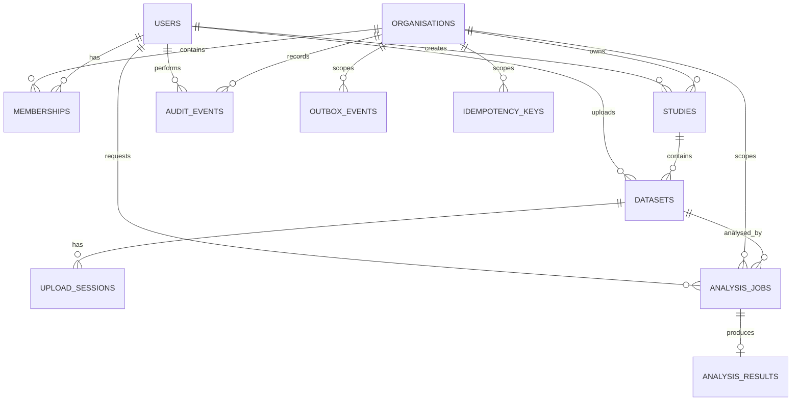

## 4. Entity Relationship Diagram

Some supporting relationships, such as references to a dataset version, may be implemented as additional columns or tables as the product evolves.

The current PostgreSQL schema is also available as a DBML diagram source at
[`database/eeg-lab.dbml`](database/eeg-lab.dbml). It reflects the versioned SQL
migrations under `packages/backend/migrations/versions/`.

