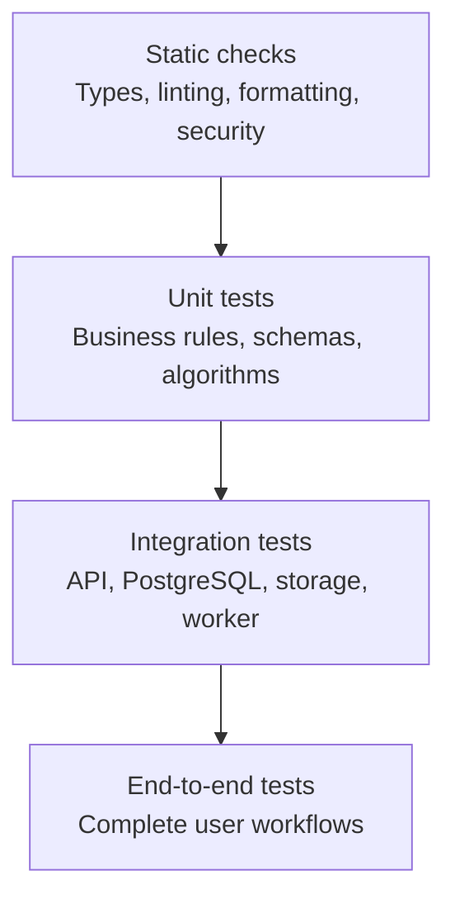

# EEG Lab — Testing Strategy

## 1. Purpose

This document defines the testing approach for EEG Lab, an independent research-oriented neuroscience SaaS application.

EEG Lab combines a web frontend, API, relational database, object storage, asynchronous workers, and scientific computations. Testing must verify not only that individual functions work, but also that these components behave correctly together under normal operation, invalid input, concurrent requests, and failure conditions.

The primary goals are to:

- Protect scientific calculation correctness.
- Prevent cross-organisation data access.
- Verify database integrity and transaction behaviour.
- Validate untrusted EEG uploads safely.
- Ensure reliable asynchronous processing.
- Maintain API and frontend contracts.
- Detect regressions through continuous integration.
- Demonstrate professional software engineering practices.

## 2. Testing Principles

1. Test observable behaviour rather than implementation details.
2. Test critical business rules at the appropriate system boundary.
3. Use deterministic fixtures for scientific calculations.
4. Use real PostgreSQL for database-specific behaviour.
5. Test authorisation negatively, not only with authorised users.
6. Treat worker execution as potentially duplicated.
7. Test failure recovery as well as successful execution.
8. Keep unit tests fast and integration tests representative.
9. Avoid relying on live cloud resources for every test.
10. Make failures reproducible and actionable.
11. Keep test data synthetic unless a separate approved test-data process exists.
12. Do not equate high code coverage with correctness.

## 3. Testing Pyramid



### Static checks

Run on every pull request:

- Formatting.
- Linting.
- Type checking.
- Dependency and secret scanning where configured.
- Infrastructure validation where relevant.

### Unit tests

Test isolated behaviour quickly:

- Pydantic validation.
- Permission decisions.
- State transitions.
- Numerical calculations.
- Metadata validation.
- Idempotency rules.

### Integration tests

Test component interactions:

- FastAPI and PostgreSQL.
- Database transactions.
- SQL migration files.
- Object-storage interactions.
- Outbox dispatch.
- Celery workers.
- Analysis result persistence.

### End-to-end tests

Test critical workflows from the user's perspective through the frontend and backend.

Do not use end-to-end tests for every edge case. Reserve them for high-value workflows.

## 4. Testing Tools

### Frontend

| Tool                  | Purpose                        |
| --------------------- | ------------------------------ |
| Vitest                | Unit and integration tests     |
| React Testing Library | Component behaviour            |
| Playwright            | Browser-based end-to-end tests |
| TypeScript            | Static type checking           |
| ESLint                | Code-quality checks            |

### Backend and worker

| Tool                                        | Purpose                                           |
| ------------------------------------------- | ------------------------------------------------- |
| pytest                                      | Test runner                                       |
| HTTPX                                       | API testing                                       |
| Pydantic                                    | Request and result validation                     |
| Psycopg 3                                   | Database integration                              |
| Psycopg-based SQL migration runner          | Migration validation                              |
| NumPy                                       | Numerical test fixtures and expected calculations |
| Testcontainers or an equivalent environment | Disposable PostgreSQL integration tests           |

### Infrastructure

- Terraform formatting and validation.
- Static infrastructure security checks.
- Container image scanning.
- Deployment smoke tests.

Use the smallest set of tools that provides the required coverage.

## 5. Test Directory Structure

A possible repository layout:

```text
eeg-lab/
├── packages/
│   ├── frontend/
│   │   └── src/
│   │       ├── components/
│   │       └── ...
│   └── backend/
│       ├── app/
│       └── tests/
│           ├── unit/
│           ├── integration/
│           ├── api/
│           ├── security/
│           └── fixtures/
├── workers/
│   └── analysis/
│       ├── app/
│       └── tests/
│           ├── unit/
│           ├── integration/
│           └── fixtures/
├── tests/
│   └── e2e/
└── infrastructure/
    └── terraform/
```

Adapt this structure to the actual repository. Avoid duplicating shared fixtures unnecessarily.

## 6. Scientific Correctness Tests

Scientific calculations need explicit mathematical expectations. Tests must not merely check that a result exists or that a function returns a number.

### Initial analysis

For each EEG channel, EEG Lab calculates:

- Mean.
- Standard deviation.
- Minimum.
- Maximum.
- Peak-to-peak range.
- Valid sample count.

Define the treatment of non-finite values and the standard-deviation convention in the algorithm specification.

For the initial implementation, a reasonable contract is:

- Exclude non-finite values from descriptive statistics.
- Report the valid sample count.
- Use population standard deviation (`ddof=0`).
- Reject a channel with no valid samples.
- Reject an entire recording if its structure or metadata is invalid.

If the implementation adopts different behaviour, document it explicitly and update the tests.

### Example fixture

```python
import numpy as np

signal = np.array([1.0, 2.0, 3.0, 4.0])
```

Expected values:

| Metric                        |         Expected value |
| ----------------------------- | ---------------------: |
| Mean                          |                    2.5 |
| Population standard deviation | Approximately 1.118034 |
| Minimum                       |                    1.0 |
| Maximum                       |                    4.0 |
| Peak-to-peak range            |                    3.0 |
| Valid sample count            |                      4 |

Use floating-point tolerances for comparisons rather than requiring exact binary equality.

Example:

```python
assert result["mean"] == pytest.approx(2.5)
assert result["standard_deviation"] == pytest.approx(
    np.std(signal, ddof=0)
)
```

### Required numerical test cases

- Constant-valued signals.
- Positive and negative values.
- Single-sample channels.
- Missing or non-finite samples.
- All-invalid channels.
- Very small and large valid values.
- Empty arrays.
- Incorrect dimensions.
- Unsupported dtypes.
- Channel metadata that does not match array dimensions.
- Invalid sampling frequency.

The accepted behaviour must be consistent between the numerical implementation, API contract, and UI.

### Scientific invariants

For every successfully analysed channel:

- Mean is finite.
- Standard deviation is finite and non-negative.
- Minimum does not exceed maximum.
- Peak-to-peak range is non-negative.
- Valid sample count is positive.
- Peak-to-peak range equals maximum minus minimum within the defined numerical tolerance.

These invariants are useful checks, but they do not replace comparison against known expected results.

## 7. Synthetic EEG Fixtures

Create deterministic synthetic datasets for testing.

Recommended fixtures:

1. A simple fixed numerical array for exact statistics.
2. A multichannel signal with different known channel values.
3. A sinusoidal signal for time-axis and visualisation tests.
4. A signal containing non-finite samples.
5. An empty array.
6. An array with the wrong orientation.
7. A malformed or unsupported file.
8. An array that exceeds configured resource limits.

For repeatable generated signals, use a fixed random seed.

Never make tests depend on random values generated afresh without a deterministic seed or an explicit property-based testing strategy.

Do not use real participant recordings merely because they are convenient test fixtures.

## 8. API Tests

Test endpoint behaviour using FastAPI's supported test integration with HTTPX.

### Study endpoints

- Valid study creation returns `201`.
- Missing or blank names are rejected.
- Unauthorised creation is rejected.
- Updating an archived study follows the documented policy.
- Pagination returns deterministic results.
- Invalid cursors are rejected safely.

### Dataset endpoints

- Dataset creation requires a valid parent study.
- A study from another organisation cannot be referenced.
- Unsupported file formats are rejected.
- Invalid metadata is rejected.
- Dataset state cannot be set arbitrarily by a client.
- A dataset cannot become ready before validation succeeds.

### Analysis endpoints

- Non-ready datasets cannot be analysed.
- Invalid analysis parameters are rejected.
- Duplicate submission with the same idempotency key does not create duplicate logical jobs.
- Reusing an idempotency key with different input returns `409`.
- A job's status reflects persisted state.
- Results are unavailable before successful completion.
- Failed jobs do not expose internal exceptions.
- Result provenance is returned correctly.

### Error responses

Verify that errors consistently include:

- A stable error code.
- A safe human-readable message.
- Field details where applicable.
- A request ID.

Do not assert on incidental internal exception wording.

## 9. Multi-Tenancy and Authorisation Tests

Tenant isolation is a critical security requirement.

Create at least two organisations with separate users, memberships, studies, datasets, and analysis jobs.

Test that a user from Organisation A cannot read or modify Organisation B's resources by:

- Changing the organisation ID in the URL.
- Substituting another organisation's study ID.
- Substituting another organisation's dataset ID.
- Substituting another organisation's analysis ID.
- Reusing an identifier obtained from a different context.
- Submitting a dataset from another organisation in an analysis request.
- Attempting to use another organisation's upload session.

Test all role boundaries:

- Owners can perform permitted administrative operations.
- Researchers can perform permitted scientific workflows.
- Viewers cannot modify data or submit analyses.
- Unauthenticated users cannot access protected resources.
- Disabled users or removed memberships cannot continue using previously granted access.

### Database-level integrity

Where composite tenant foreign keys are used, test that the database rejects cross-organisation relationships even when application-level validation is bypassed.

### Query scoping

Verify that organisation filtering is applied before pagination and aggregation. A correct permission check on a parent resource does not automatically make every child query safe.

## 10. Database and Transaction Tests

Use real PostgreSQL for tests that depend on PostgreSQL behaviour.

Test:

- Fresh schema creation.
- SQL migration upgrade execution.
- Unique membership constraints.
- Foreign key enforcement.
- Composite tenant constraints.
- Transaction rollback.
- Concurrent updates.
- Idempotency-key uniqueness.
- Outbox creation in the same transaction as job creation.
- Result persistence and job completion.
- Last-owner protection.
- Pagination ordering.
- Archival behaviour.

### Transactional job creation

A job submission must not produce a committed job without the corresponding durable dispatch event.

Test the transaction boundary:

1. Begin the transaction.
2. Create the analysis job.
3. Create its outbox event.
4. Commit both together.
5. Verify both records exist.

If either operation fails, verify that neither record is left in a partially committed state.

### Migration tests

Test migrations from:

- An empty database.
- The previous released schema, when applicable.
- A representative database containing existing rows.

For incompatible schema changes, verify the migration plan before deployment.

## 11. Background Worker Tests

Background jobs are distributed operations. Assume messages may be delayed, delivered more than once, or processed after a worker restart.

### Job lifecycle

Test:

- `queued` transitions to `running`.
- Successful execution transitions to `succeeded`.
- Expected execution errors transition to `failed` or trigger an explicitly permitted retry.
- Queued jobs can be cancelled.
- Running jobs follow the documented cancellation policy.
- Terminal jobs cannot be silently reopened.
- A worker checks persisted state before committing results.

### Idempotent execution

Deliver the same task more than once.

Verify that:

- Only one canonical result is committed.
- Repeated execution does not corrupt the dataset.
- A duplicate message cannot overwrite a successful result with a failure.
- Duplicate dispatch is safe.
- State transitions remain valid.

### Failure and recovery

Simulate:

- Worker termination during execution.
- Object storage temporarily unavailable.
- Database connection loss.
- Invalid analysis input.
- Outbox dispatch failure.
- A job that exceeds its lease or execution timeout.
- Exhausted retry attempts.

Verify that failures are visible and that retry behaviour is bounded.

### Avoid false confidence from eager mode

Celery eager mode can be useful for some unit tests, but it does not reproduce the behaviour of a real broker and worker process.

Use a real test broker or a representative integration environment for critical delivery, retry, and worker-lifecycle tests.

## 12. Object Storage Tests

Test storage behaviour through a small abstraction or adapter that can be replaced with a test implementation.

Verify:

- Object keys are generated by the server.
- Bucket access is private by default.
- Upload authorisations expire.
- Finalisation checks the expected object.
- The server verifies actual file size.
- Checksums are calculated or verified correctly.
- Failed validation does not mark a dataset ready.
- Abandoned uploads can be cleaned up safely.
- Temporary URLs and credentials are not logged.
- An object from another dataset cannot be attached by changing a client-supplied key.

Use provider-specific integration tests for signed URLs, object generation identifiers, and IAM policies where practical.

## 13. Frontend Component Tests

Use Vitest and React Testing Library to test user-visible behaviour.

Test components such as:

- Study creation form.
- Dataset upload form.
- Upload progress and validation states.
- Dataset metadata panel.
- Channel selector.
- EEG chart container.
- Analysis submission control.
- Job status indicator.
- Result summary.
- Error messages.
- Empty states.

Verify:

- Inputs have accessible labels.
- Keyboard navigation works for interactive controls.
- Loading states are displayed.
- Validation errors are understandable.
- Failed API requests do not display fabricated success.
- Viewers do not see enabled write controls.
- Data refreshes correctly after mutations.
- Long-running jobs show current status.

Do not test implementation details such as internal component state when the same behaviour can be tested through the rendered interface.

## 14. Visualisation Tests

Scientific charts require additional correctness checks.

Test that:

- The time axis uses the supplied sampling frequency.
- Channel selection displays the correct channel.
- Displayed statistics match API results.
- Unknown units are not presented as known units.
- Empty and invalid data have meaningful states.
- Large recordings respect documented rendering limits.
- Downsampling, when implemented, does not alter persisted analysis results.
- Chart labels and alternative summaries are available.

A chart that renders without throwing an exception is not necessarily scientifically correct.

## 15. End-to-End Tests

Use Playwright for a small number of critical user workflows.

### Workflow A: Create and analyse a dataset

1. Sign in using the supported test authentication configuration.
2. Select an authorised organisation.
3. Create a study.
4. Register a synthetic EEG dataset.
5. Upload the file.
6. Finalise the upload.
7. Wait for validation to complete.
8. Open the dataset detail page.
9. Submit a descriptive analysis.
10. Wait for the job to finish.
11. Open the result view.
12. Verify expected numerical output and provenance.

Use deterministic fixture data so the expected results are known.

### Workflow B: Permission boundaries

1. Sign in as a viewer.
2. Open a study and dataset.
3. Verify that read access works.
4. Verify that write controls are unavailable or disabled appropriately.
5. Attempt the corresponding protected API operation.
6. Verify that the backend rejects it.

Hiding a button is not sufficient proof of authorisation.

### Workflow C: Failure handling

1. Attempt to upload an invalid recording.
2. Verify that validation fails.
3. Verify that the dataset never becomes ready.
4. Verify that the UI explains the failure safely.
5. Verify that no successful analysis can be submitted for the invalid dataset.

## 16. Contract and Type Consistency Tests

The API is defined by FastAPI and Pydantic.

Where practical:

- Generate an OpenAPI specification in CI.
- Generate TypeScript client types from OpenAPI.
- Check generated files for unexpected changes.
- Validate representative API responses against the contract.
- Ensure frontend and backend agree on status values and error codes.

Avoid maintaining duplicated type definitions when automated generation is reliable and easier to maintain.

## 17. Performance and Resource Tests

Performance testing should focus on the application's likely bottlenecks.

Test:

- Dataset-list queries at representative sizes.
- Pagination behaviour.
- Concurrent analysis submissions.
- Worker processing time for supported dataset sizes.
- Memory use while loading recordings.
- Chart rendering with maximum supported sample counts.
- Database connection-pool behaviour.
- Recovery after a temporary dependency outage.

Define realistic limits for the MVP before claiming support for large recordings.

Do not run expensive benchmarks on every pull request. Use targeted smoke tests in CI and scheduled or release-oriented load tests where justified.

## 18. Security Testing

Include checks for:

- Cross-tenant access.
- Broken object-level authorisation.
- SQL injection resistance.
- Unsafe file parsing.
- Oversized uploads.
- Malformed JSON and metadata.
- Excessive resource consumption.
- Secret leakage.
- Signed URL leakage.
- Unauthorised role changes.
- Unsafe error responses.
- Dependency vulnerabilities.
- Container image vulnerabilities.
- Public exposure of private object storage.
- Insecure default configuration.

All SQL values must be parameterised. Dynamic SQL identifiers, when unavoidable, must be selected from trusted allowlists rather than interpolated from user input.

## 19. Continuous Integration Gates

Every pull request should pass the checks relevant to the changed code.

### Required gates

- Formatting.
- Linting.
- Type checking.
- Frontend unit tests.
- Backend unit tests.
- Scientific correctness tests.
- Database integration tests.
- API and authorisation tests.
- Worker lifecycle tests where relevant.
- Production frontend build.
- Backend import and startup checks.
- SQL migration checks.

End-to-end tests should run on pull requests when practical and must run before a release or production deployment.

Do not weaken critical security or scientific correctness gates solely to make a pipeline green.

For fast local feedback, the Husky pre-commit hook uses lint-staged to run Ruff on staged Python files and ESLint/Prettier on staged frontend source files. These hooks do not replace any required CI gate.

## 20. Test Data and Environment Management

Use synthetic test data exclusively for ordinary development and CI.

Requirements:

- Keep fixtures small and deterministic.
- Generate larger files only for resource-limit tests.
- Avoid committing large binary recordings unnecessarily.
- Keep secrets out of fixture files.
- Use isolated test databases.
- Clean up temporary storage objects.
- Avoid shared mutable fixtures across tests.
- Ensure parallel tests cannot interfere with one another.

If real research data is ever introduced, establish an explicit approval, access, retention, and anonymisation process first.

## 21. Coverage and Quality Targets

Code coverage is a diagnostic, not the primary success criterion. Do not set a
single line-coverage percentage as a release gate.

Prioritise instead:

- High coverage of numerical edge cases.
- Complete coverage of critical role and tenant-isolation scenarios.
- Explicit tests for all supported analysis state transitions.
- End-to-end coverage of the primary workflow.

Do not chase coverage by testing trivial getters or writing assertions that provide little confidence.

Critical security boundaries and scientific algorithms deserve stronger targeted tests than their raw line coverage might suggest.

## 22. Defect Handling

When a defect is found:

1. Reproduce the failure.
2. Determine the affected boundary.
3. Add a regression test.
4. Fix the underlying cause.
5. Run the relevant test suite.
6. Review whether other endpoints or workflows share the same defect.
7. Document the impact if it affects scientific results, security, or persisted data.

For defects that could have altered persisted scientific results, consider whether existing results need to be invalidated, recomputed, or marked with an affected algorithm version.

## 23. Definition of Done

A feature is complete when:

1. Its expected behaviour is tested.
2. Invalid inputs are handled.
3. Authorisation is enforced server-side.
4. Relevant database constraints are tested.
5. Scientific calculations have known expected outputs where applicable.
6. Failure and retry behaviour are covered for asynchronous work.
7. Frontend loading, success, empty, and error states are implemented.
8. The relevant automated checks pass.
9. No sensitive test data or credentials are committed.
10. Documentation and API contracts are updated.
11. The feature does not introduce unsupported medical or diagnostic claims.

Place frontend tests in colocated `__tests__` directories next to the code they exercise.
