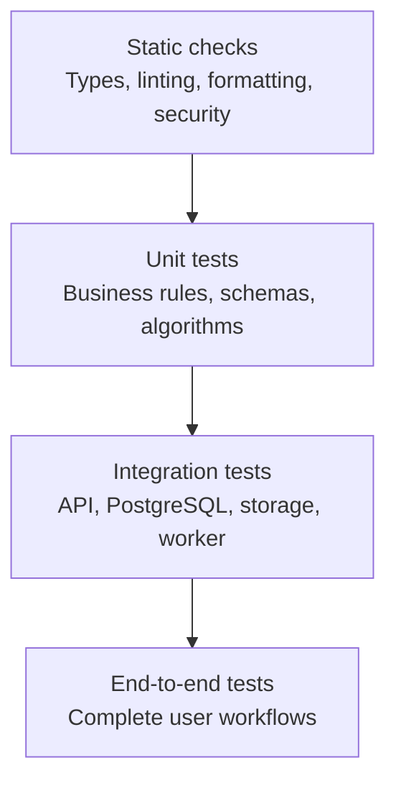

## 3. Testing Pyramid

### Static checks

Run on every pull request:

- Formatting.
- Linting.
- Type checking.
- Dependency and secret scanning where configured.
- Infrastructure validation where relevant.

### Unit tests

Test isolated behaviour quickly:

- Pydantic validation.
- Permission decisions.
- State transitions.
- Numerical calculations.
- Metadata validation.
- Idempotency rules.

### Integration tests

Test component interactions:

- FastAPI and PostgreSQL.
- Database transactions.
- SQL migration files.
- Object-storage interactions.
- Outbox dispatch.
- Celery workers.
- Analysis result persistence.

### End-to-end tests

Test critical workflows from the user's perspective through the frontend and backend.

Do not use end-to-end tests for every edge case. Reserve them for high-value workflows.

