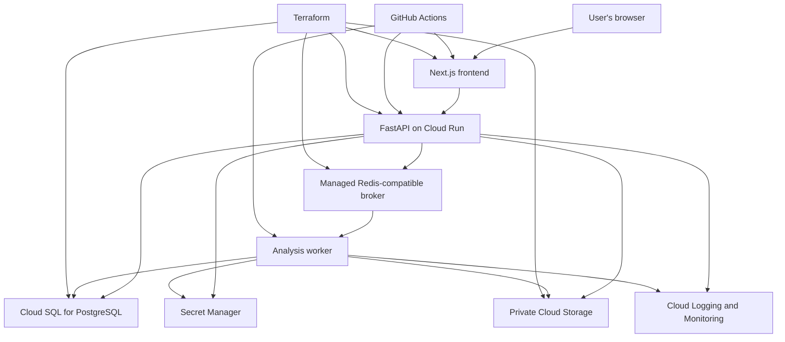

## 6. Google Cloud Architecture

The proposed initial production architecture is:

This is a logical architecture, not a guarantee that every named service is available in every region or suitable for every budget.

### Frontend

Deploy the Next.js application to Cloud Run or another compatible hosting service.

If deployed on Cloud Run, verify the application's server-rendering requirements, container startup behaviour, and port configuration.

Use HTTPS for public traffic.

### API

Deploy FastAPI as a Cloud Run service.

Requirements:

- Configure an appropriate request timeout.
- Set concurrency and instance limits deliberately.
- Configure health checks.
- Apply request-size limits.
- Use structured logs.
- Access PostgreSQL and object storage using the service identity.
- Keep secrets in Secret Manager or an equivalent managed secret facility.
- Avoid storing durable state on the container filesystem.

Do not perform long-running scientific computations inside an HTTP request handler.

### PostgreSQL

Use Cloud SQL for PostgreSQL if the selected budget and availability requirements justify it.

Requirements:

- Avoid public database exposure where practical.
- Restrict access to approved service identities and network paths.
- Configure backups.
- Document recovery objectives.
- Monitor connections and resource usage.
- Apply migrations through a controlled release process.
- Configure connection pooling appropriately for serverless concurrency.

### Object storage

Use a private Cloud Storage bucket for source recordings.

Requirements:

- Block public access.
- Use least-privilege IAM permissions.
- Use server-generated object keys.
- Apply upload size and expiry policies.
- Avoid permanent public URLs.
- Use short-lived signed URLs only where required.
- Record object identity and checksum metadata.
- Define retention and cleanup behaviour.

### Background worker

Deploy the Celery worker separately from the API.

The worker should:

- Process queued analyses.
- Load validated recordings.
- Enforce resource limits.
- Persist results and state transitions.
- Retry only recoverable failures.
- Avoid logging sensitive payloads.
- Shut down gracefully.
- Recover from duplicate or delayed task messages.

### Redis-compatible broker

Select a managed broker that is compatible with the required Celery transport and semantics.

Verify supported Redis protocol features, networking, authentication, TLS, persistence, and operational limits before committing to a provider.

Do not assume that every managed Redis offering supports every Celery configuration.

### Important deployment distinction

Cloud Run request-driven services may scale down when idle. Background workers require an execution model that continues to process queued work reliably.

Choose and test the worker deployment model explicitly. Do not assume that deploying a normal request-driven container automatically provides a continuously running Celery worker.

If the required managed-service combination is too expensive or operationally complex for the portfolio MVP, use a simpler documented deployment while preserving the application boundaries.

