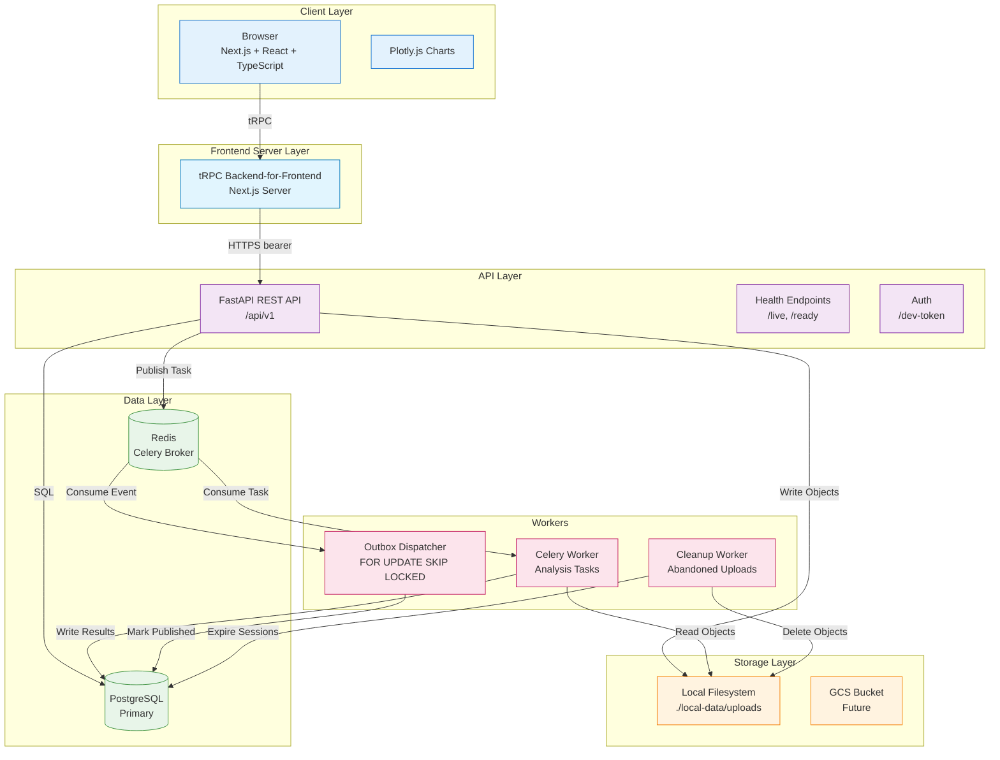
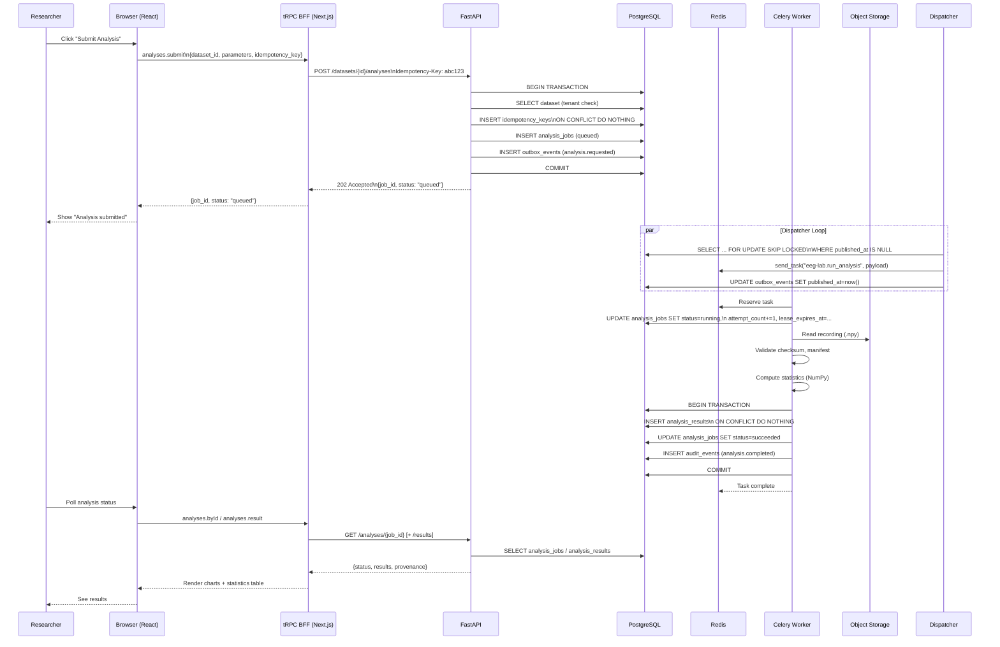
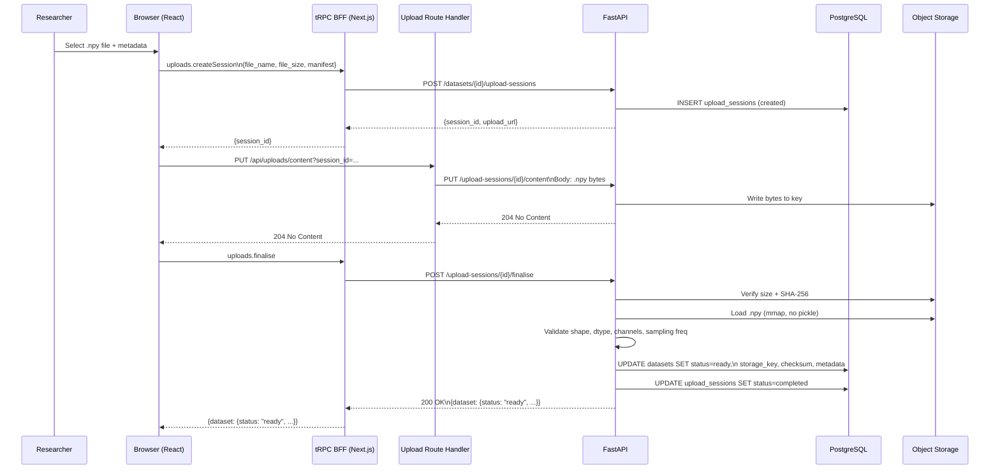
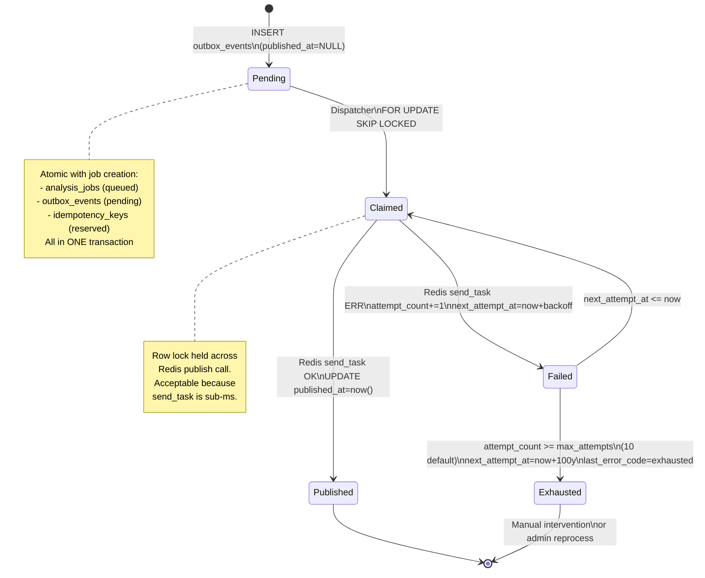
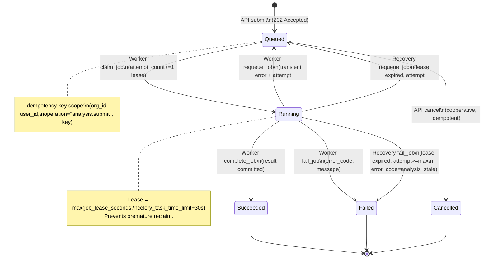

# Architecture and Data-Flow Diagrams

This document contains Mermaid diagrams for EEG Lab's architecture. Render with any Markdown viewer that supports Mermaid (GitHub, GitLab, VS Code with extension, etc.).

## 1. High-Level System Architecture



## 2. Request Lifecycle (Analysis Submission)

The browser never calls FastAPI directly: it calls tRPC procedures on the Next.js BFF, which forwards authenticated REST requests.



## 3. Upload & Validation Flow

Only recording metadata travels through the tRPC BFF; the raw array bytes stream through the `/api/uploads/content` route handler.



## 4. Tenant Isolation Model

```mermaid
graph TD
    subgraph "Organisation A"
        UserA1[User: alice\nRole: owner]
        UserA2[User: bob\nRole: researcher]
        StudyA1[Study: "Sleep Study"]
        DatasetA1[Dataset: "night1.npy"]
        JobA1[Analysis Job\nstatus: succeeded]
        ResultA1[Analysis Result\nprovenance + channels]
    end

    subgraph "Organisation B"
        UserB1[User: charlie\nRole: viewer]
        StudyB1[Study: "Seizure Study"]
        DatasetB1[Dataset: "patient2.npy"]
    end

    UserA1 -->|owns| StudyA1
    UserA2 -->|member| StudyA1
    StudyA1 -->|contains| DatasetA1
    DatasetA1 -->|produced| JobA1
    JobA1 -->|generated| ResultA1

    UserB1 -->|member| StudyB1
    StudyB1 -->|contains| DatasetB1

    classDef orgA fill:#e3f2fd,stroke:#1976d2
    classDef orgB fill:#fff3e0,stroke:#f57c00
    classDef cross fill:#ffebee,stroke:#c62828,stroke-dasharray: 5 5

    class UserA1,UserA2,StudyA1,DatasetA1,JobA1,ResultA1 orgA
    class UserB1,StudyB1,DatasetB1 orgB

    Note right of UserA1: All queries filtered by\norganisation_id from JWT
    Note right of UserB1: Cannot see Org A resources\n(404 not 403)
    Note left of ResultA1: Provenance includes\nchecksum + algorithm version
```

## 5. Outbox Pattern (Reliable Event Dispatch)



## 6. Analysis Job State Machine



## 7. Data Model Relationships

```mermaid
erDiagram
    ORGANISATIONS ||--o{ MEMBERSHIPS : has
    ORGANISATIONS ||--o{ STUDIES : owns
    ORGANISATIONS ||--o{ DATASETS : owns
    ORGANISATIONS ||--o{ ANALYSIS_JOBS : submits
    ORGANISATIONS ||--o{ ANALYSIS_RESULTS : produces
    ORGANISATIONS ||--o{ OUTBOX_EVENTS : emits
    ORGANISATIONS ||--o{ IDEMPOTENCY_KEYS : reserves
    ORGANISATIONS ||--o{ AUDIT_EVENTS : records

    USERS ||--o{ MEMBERSHIPS : belongs
    USERS ||--o{ STUDIES : creates
    USERS ||--o{ DATASETS : uploads
    USERS ||--o{ ANALYSIS_JOBS : requests
    USERS ||--o{ AUDIT_EVENTS : acts

    STUDIES ||--o{ DATASETS : contains
    DATASETS ||--o{ UPLOAD_SESSIONS : receives
    DATASETS ||--o{ ANALYSIS_JOBS : analyses
    DATASETS ||--o{ ANALYSIS_RESULTS : results_for

    ANALYSIS_JOBS ||--|| ANALYSIS_RESULTS : produces
    ANALYSIS_JOBS ||--o{ OUTBOX_EVENTS : triggers
    ANALYSIS_JOBS ||--|| IDEMPOTENCY_KEYS : deduplicates

    UPLOAD_SESSIONS {
        uuid id PK
        uuid dataset_id FK
        enum status
        string upload_method
        timestamp expires_at
    }

    DATASETS {
        uuid id PK
        uuid organisation_id FK
        uuid study_id FK
        enum status
        enum format
        string storage_key
        string checksum_sha256
        int file_size_bytes
        float sampling_frequency_hz
        int channel_count
        int sample_count
        json channel_names
        json channel_units
    }

    ANALYSIS_JOBS {
        uuid id PK
        uuid organisation_id FK
        uuid dataset_id FK
        uuid requested_by FK
        enum analysis_type
        string algorithm_version
        json parameters
        enum status
        int attempt_count
        int max_attempts
        string error_code
        string error_message
        uuid idempotency_key
        timestamp lease_expires_at
    }

    ANALYSIS_RESULTS {
        uuid id PK
        uuid organisation_id FK
        uuid job_id FK UNIQUE
        uuid dataset_id FK
        string dataset_checksum_sha256
        string algorithm_version
        string result_schema_version
        json results
        json provenance
    }

    OUTBOX_EVENTS {
        uuid id PK
        uuid organisation_id FK
        string event_type
        string aggregate_type
        uuid aggregate_id
        json payload
        timestamp published_at
        int attempt_count
        timestamp next_attempt_at
        string last_error_code
    }

    IDEMPOTENCY_KEYS {
        uuid id PK
        uuid organisation_id FK
        uuid user_id FK
        string operation
        string key
        string request_hash
        int response_status
        json response_body
        uuid resource_id
        timestamp expires_at
    }
```

## 8. Deployment Architecture (Target - Phase 10)

```mermaid
graph TB
    subgraph "Internet"
        Users[Users]
    end

    subgraph "GCP Project"
        subgraph "VPC - Private"
            subgraph "Cloud Run - API"
                API1[API Instance 1]
                API2[API Instance 2]
                API3[API Instance N]
            end

            subgraph "Cloud Run - Worker"
                Worker1[Worker Instance 1]
                Worker2[Worker Instance 2]
            end

            subgraph "Cloud Run - Frontend"
                FE1[Frontend Instance 1]
                FE2[Frontend Instance N]
            end

            subgraph "Cloud SQL - PostgreSQL"
                PGPrimary[(Primary)]
                PGReplica[(Read Replica)]
            end

            subgraph "Memorystore - Redis"
                RedisPrimary[(Primary)]
                RedisReplica[(Replica)]
            end

            subgraph "Cloud Storage"
                Bucket[(eeg-lab-uploads\nVersioned, Private)]
            end

            subgraph "Secret Manager"
                Secrets[API Keys, DB Password,\nJWT Secret, Redis Auth]
            end
        end

        subgraph "Cloud Run - Dispatcher (Cloud Scheduler)"
            Scheduler[Cloud Scheduler\nEvery 30s] --> Dispatcher[Dispatcher Job]
        end

        subgraph "Monitoring"
            Logging[Cloud Logging]
            Monitoring[Cloud Monitoring\n+ Alerting]
            Trace[Cloud Trace]
        end
    end

    Users -->|HTTPS| FE1
    Users -->|HTTPS| API1
    FE1 -->|API Calls| API1
    API1 -->|SQL| PGPrimary
    API1 -->|Tasks| RedisPrimary
    API1 -->|Objects| Bucket
    API1 -->|Secrets| Secrets
    Worker1 -->|SQL| PGPrimary
    Worker1 -->|Tasks| RedisPrimary
    Worker1 -->|Objects| Bucket
    Dispatcher -->|SQL| PGPrimary
    Dispatcher -->|Tasks| RedisPrimary

    API1 -.->|Logs/Metrics| Logging
    API1 -.->|Traces| Trace
    Worker1 -.->|Logs/Metrics| Logging
    Worker1 -.->|Traces| Trace

    classDef run fill:#e3f2fd,stroke:#1976d2
    classDef sql fill:#e8f5e9,stroke:#388e3c
    classDef redis fill:#fff3e0,stroke:#f57c00
    classDef storage fill:#fce4ec,stroke:#c2185b
    classDef secret fill:#f3e5f5,stroke:#7b1fa2
    classDef monitor fill:#f1f8e9,stroke:#689f38

    class API1,API2,API3,Worker1,Worker2,FE1,FE2,Dispatcher run
    class PGPrimary,PGReplica sql
    class RedisPrimary,RedisReplica redis
    class Bucket storage
    class Secrets secret
    class Logging,Monitoring,Trace monitor
```

---

_Diagrams rendered with Mermaid. For interactive viewing, open in GitHub/GitLab or VS Code with Mermaid extension._
