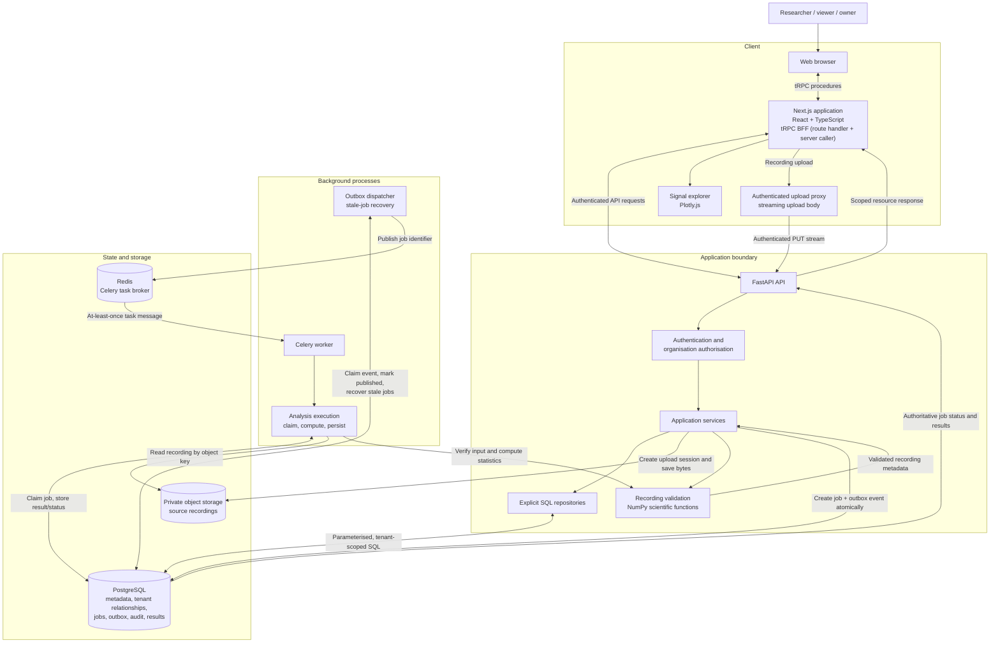

# EEG Lab Architecture

This logical architecture shows the implemented application boundaries and
runtime dependencies. The API is a modular monolith; analysis and outbox
dispatch run as separate processes. PostgreSQL owns durable state, Redis
transports task messages, and private object storage holds recording bytes.

## Boundary notes

- The browser can present organisation and resource identifiers, but the API
  derives the authenticated identity and verifies membership and role before
  authorising access.
- The browser calls tRPC procedures on the Next.js BFF, which reads the HttpOnly
  session cookie, resolves the active organisation, and forwards authenticated
  REST requests; it never bypasses API authorisation.
- The frontend upload proxy forwards the browser's authenticated session to
  the backend-mediated content endpoint. File validation and storage writes
  remain server-side.
- The dispatcher publishes job identifiers; it does not put the recording or
  analysis result in Redis.
- The worker reloads job and dataset state from PostgreSQL and reads the source
  recording from object storage. Duplicate messages do not make Redis the
  source of truth.
- The application can use local storage in development or the configured
  private object-storage adapter. The diagram does not imply a specific cloud
  deployment topology.
