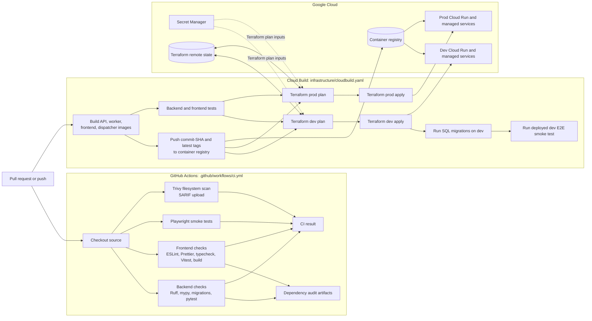

# CI/CD Pipeline

This diagram distinguishes the GitHub Actions validation workflow from the
Cloud Build deployment configuration. GitHub Actions runs on pull requests and
pushes to `main`; it validates but does not deploy. Cloud Build builds and
publishes images, runs backend/frontend tests, applies Terraform, and runs
migrations plus smoke tests for the dev path.

**Configuration caveats:** the Cloud Build YAML comments describe intended
trigger routing (`main` to dev and `v*` tags to prod), but this file contains no
branch/tag conditions; those must be enforced by the configured Cloud Build
triggers. Both dev and prod plan/apply steps are present in this YAML. The
configured release sequence runs migrations and smoke tests only for dev; it
does not define a production migration or production smoke-test step. The
GitHub Actions workflow and Cloud Build are separate configurations; this
diagram does not imply that a successful GitHub Actions run automatically
starts Cloud Build.
