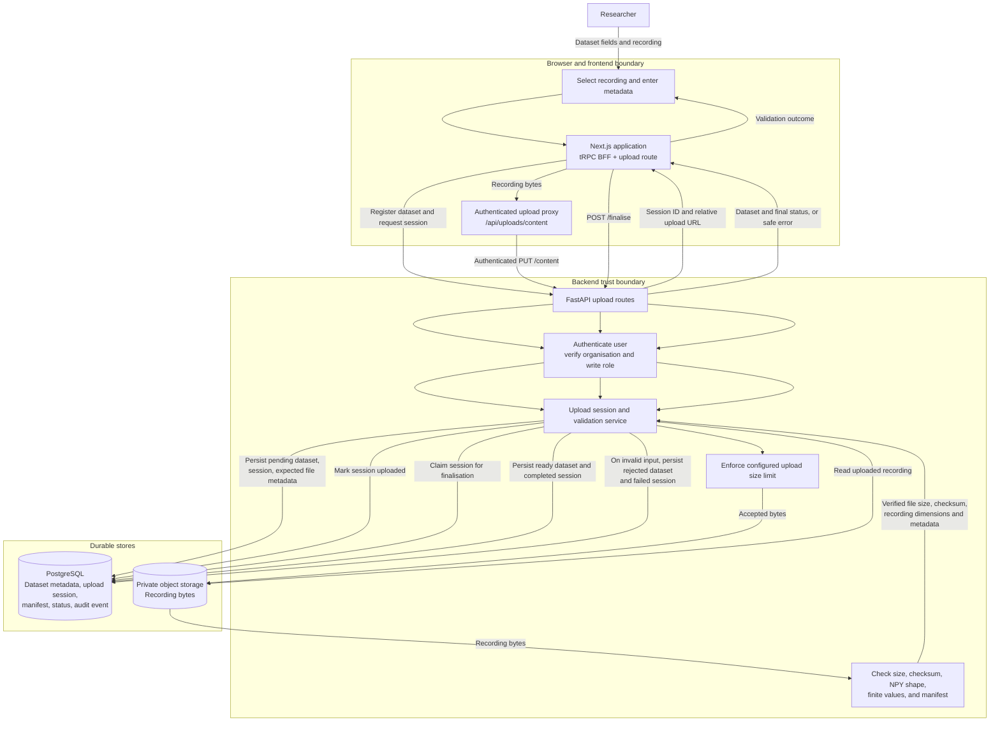

# Dataset Upload and Validation Data Flow

The current upload is mediated by the authenticated API. Registering the dataset
and finalising the upload are tRPC procedures executed by the Next.js BFF; the
recording bytes travel through the dedicated upload route, which forwards the
browser request to FastAPI. The API writes the recording to private storage.
Finalisation validates the recording synchronously.

The upload session, generated object key, expected size/checksum, and supplied
manifest are persisted before bytes are accepted. Dataset status becomes
`ready` only after server-side validation succeeds; invalid recordings are
recorded as rejected. This path does not use Celery or Redis.
