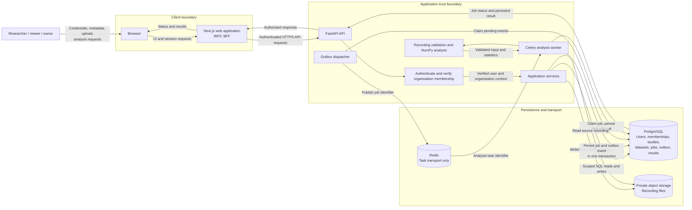

# System Data Flow

This Level 0/1 data-flow view identifies the main actors, processes, data
stores, and external transport. Organisation membership and resource access
are verified by the API; the browser is not an authority for tenant access. The
browser calls tRPC procedures on the Next.js BFF, which forwards authenticated
REST requests to FastAPI.

Redis carries task notifications but is not the source of truth for job state.
PostgreSQL stores the authoritative job lifecycle; the recording stays in
private storage and is referenced by object key and validated metadata.
