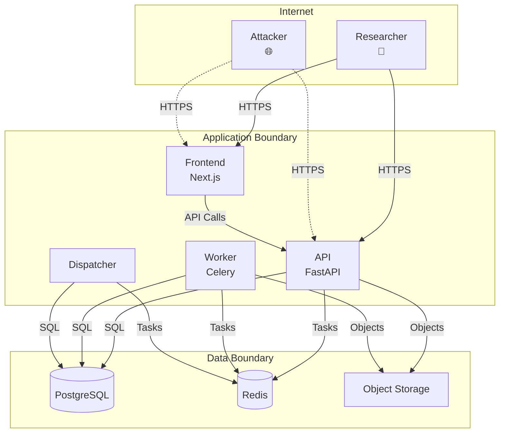

# Threat Model

EEG Lab threat model using STRIDE methodology. This is a living document updated with each phase.

## System Overview

| Attribute            | Value                                                                         |
| -------------------- | ----------------------------------------------------------------------------- |
| **System**           | EEG Lab — Neuroscience Research SaaS                                          |
| **Boundary**         | Multi-tenant web application (API + Frontend + Workers)                       |
| **Data Sensitivity** | Research EEG recordings (synthetic), analysis results, user PII (email, name) |
| **Compliance**       | Research-only, no PHI, no clinical data                                       |
| **Deployment**       | Local dev (Docker) → GCP Cloud Run (Phase 10)                                 |

## Trust Boundaries

## STRIDE Analysis

### Spoofing (Authentication Bypass)

| ID   | Threat                                | Likelihood | Impact   | Mitigation                                                                     | Status         |
| ---- | ------------------------------------- | ---------- | -------- | ------------------------------------------------------------------------------ | -------------- |
| S-01 | Stolen development token              | Medium     | High     | Dev tokens only in `APP_ENV!=production`; short TTL (1h); HS256 secret rotated | ✅ Implemented |
| S-02 | JWT algorithm confusion (RS256→HS256) | Low        | Critical | `auth_jwt_algorithms` allowlist; asymmetric keys required in prod              | ✅ Implemented |
| S-03 | Session fixation                      | Low        | Medium   | Token issued per-request; no session ID in URL; secure cookies in prod         | ✅ Implemented |
| S-04 | Impersonation via `X-Request-Id`      | Low        | Low      | Request ID generated server-side if missing/invalid; not used for auth         | ✅ Implemented |
| S-05 | Idempotency key collision             | Low        | Medium   | 255-char max; per-user+org+operation scope; SHA-256 request hash               | ✅ Implemented |

### Tampering (Data Integrity)

| ID   | Threat                             | Likelihood | Impact   | Mitigation                                                                            | Status         |
| ---- | ---------------------------------- | ---------- | -------- | ------------------------------------------------------------------------------------- | -------------- |
| T-01 | SQL injection                      | Low        | Critical | Parameterised queries only; no string interpolation; psycopg3                         | ✅ Implemented |
| T-02 | Request body manipulation (upload) | Medium     | High     | Size limits (256 MB); checksum verification; manifest validation                      | ✅ Implemented |
| T-03 | Analysis parameter tampering       | Low        | Medium   | Pydantic `extra="forbid"`; algorithm version allowlist                                | ✅ Implemented |
| T-04 | Result tampering in DB             | Low        | High     | `analysis_results` UNIQUE on `job_id`; `ON CONFLICT DO NOTHING`; provenance immutable | ✅ Implemented |
| T-05 | Outbox event replay                | Low        | Medium   | `published_at` timestamp; dispatcher marks published; worker checks existing result   | ✅ Implemented |
| T-06 | Recording file substitution        | Medium     | High     | SHA-256 verified at finalise AND at worker execution; size check                      | ✅ Implemented |

### Repudiation (Audit Trail)

| ID   | Threat                   | Likelihood | Impact | Mitigation                                                                      | Status         |
| ---- | ------------------------ | ---------- | ------ | ------------------------------------------------------------------------------- | -------------- |
| R-01 | Action without audit log | Low        | Medium | All state changes emit `audit_events` (submitted, completed, failed, cancelled) | ✅ Implemented |
| R-02 | Audit log deletion       | Low        | High   | No DELETE on `audit_events`; append-only; retention policy needed               | ⚠️ Phase 10    |
| R-03 | Timestamp manipulation   | Low        | Medium | DB `now()` server-side; no client timestamps accepted                           | ✅ Implemented |

### Information Disclosure (Confidentiality)

| ID   | Threat                     | Likelihood | Impact   | Mitigation                                                                         | Status         |
| ---- | -------------------------- | ---------- | -------- | ---------------------------------------------------------------------------------- | -------------- |
| I-01 | Cross-tenant data access   | Medium     | Critical | All queries filter by `organisation_id` from verified JWT; 404 not 403             | ✅ Implemented |
| I-02 | Object storage enumeration | Low        | Medium   | Storage keys include org UUID; private buckets; no public URLs                     | ✅ Implemented |
| I-03 | Error message leakage      | Medium     | Medium   | Safe error messages (`_SAFE_FAILURE_MESSAGE`); no stack traces, SQL, keys          | ✅ Implemented |
| I-04 | Recording data in logs     | Low        | High     | Structured logging excludes request bodies; `log_level=WARNING` in prod            | ✅ Implemented |
| I-05 | JWT secret in logs/repo    | Low        | Critical | `.env` gitignored; Secret Manager in prod; `AUTH_TOKEN_SECRET` validated ≠ default | ✅ Implemented |
| I-06 | Database credentials in CI | Low        | Critical | GitHub Actions secrets; no credentials in repo                                     | ✅ Implemented |

### Denial of Service (Availability)

| ID   | Threat                         | Likelihood | Impact | Mitigation                                                                              | Status         |
| ---- | ------------------------------ | ---------- | ------ | --------------------------------------------------------------------------------------- | -------------- |
| D-01 | Large upload exhaustion        | Medium     | High   | `max_upload_bytes=256MB`; `max_channels=256`; `max_sample_count=100M`; streaming upload | ✅ Implemented |
| D-02 | Request body flood             | Medium     | Medium | `max_request_body_bytes=1MB` default; middleware enforces before handler                | ✅ Implemented |
| D-03 | Analysis job queue flood       | Low        | Medium | Per-user rate limit missing; max 3 attempts per job; dispatcher batches (100)           | ⚠️ Phase 10    |
| D-04 | Database connection exhaustion | Low        | High   | Pool limits (`min=1, max=10`); statement timeout 15s; connection timeout 5s             | ✅ Implemented |
| D-05 | Redis memory exhaustion        | Low        | Medium | Celery broker only; no result backend; TTL on events; dispatcher parks exhausted        | ✅ Implemented |
| D-06 | Worker crash loop              | Medium     | Medium | Bounded retries (`analysis_max_attempts=3`); stale job recovery; lease > task timeout   | ✅ Implemented |

### Elevation of Privilege (Authorization)

| ID   | Threat                              | Likelihood | Impact   | Mitigation                                                               | Status         |
| ---- | ----------------------------------- | ---------- | -------- | ------------------------------------------------------------------------ | -------------- |
| E-01 | Viewer submits analysis             | Medium     | High     | `require_role({OWNER, RESEARCHER})` on submit; 403 for viewer            | ✅ Implemented |
| E-02 | Researcher deletes organisation     | Low        | Critical | No DELETE endpoint for organisations; archive only                       | ✅ Implemented |
| E-03 | Cross-org job cancellation          | Low        | High     | `cancel_queued_job` filters by `organisation_id`; 404 if not found       | ✅ Implemented |
| E-04 | Privilege escalation via membership | Medium     | High     | `require_role` checks membership role; owner-only for membership changes | ✅ Implemented |
| E-05 | Worker runs as elevated DB user     | Low        | Critical | Single DB user; least privilege via app-layer checks; no raw SQL exec    | ✅ Implemented |

## Attack Surface Summary

### External (Internet-Facing)

- `POST /auth/token` — Development token issuance (dev only)
- `GET /health/live`, `GET /health/ready` — No auth
- `POST /api/v1/organisations/{org}/datasets/{ds}/upload-sessions` — Auth required
- `PUT /api/v1/.../content` — Auth required, large body
- `POST /api/v1/.../finalise` — Auth required
- `POST /api/v1/.../analyses` — Auth required, idempotency key
- `GET /api/v1/.../analyses/{job}` — Auth required
- `GET /api/v1/.../analyses/{job}/results` — Auth required
- `POST /api/v1/.../analyses/{job}/cancel` — Auth required

### Internal (VPC-Only, Phase 10)

- PostgreSQL (5432) — API, Worker, Dispatcher only
- Redis (6379) — API, Worker, Dispatcher only
- Object Storage — API, Worker only
- Secret Manager — API, Worker only

## Security Controls Matrix

| Control                   | Implementation                                       | Coverage               |
| ------------------------- | ---------------------------------------------------- | ---------------------- |
| **Authentication**        | Dev JWT (HS256) / OIDC ready                         | S-01, S-02             |
| **Authorisation**         | Role-based (owner/researcher/viewer) + tenant filter | E-01..E-04, I-01       |
| **Input Validation**      | Pydantic `extra="forbid"` + size limits              | T-01, T-02, D-01, D-02 |
| **Output Encoding**       | JSON API, no HTML rendering                          | I-03                   |
| **Audit Logging**         | `audit_events` table, 4 actions                      | R-01                   |
| **Encryption at Rest**    | PG disk encryption (managed), GCS default            | I-02                   |
| **Encryption in Transit** | TLS 1.2+ (terminated at Cloud Run)                   | All                    |
| **Secrets Management**    | `.env` local, Secret Manager prod                    | I-05, I-06             |
| **Dependency Scanning**   | `pip-audit`, `npm audit`, Trivy in CI                | Supply chain           |
| **Rate Limiting**         | Body size only; per-user missing                     | D-01, D-02             |
| **WAF / DDoS**            | Cloud Run managed (Phase 10)                         | D-01..D-06             |

## Residual Risks (Accepted)

| Risk                               | Reason                              | Compensating Control                  |
| ---------------------------------- | ----------------------------------- | ------------------------------------- |
| No per-user rate limiting          | MVP scope; dev auth only            | Body limits; small user base          |
| No audit log retention policy      | Not yet needed                      | Append-only; manual cleanup if needed |
| Dev tokens use HMAC not asymmetric | Simplicity for local dev            | Enforced `APP_ENV!=production`        |
| No CSP headers                     | API-only backend; frontend separate | Phase 10 frontend hardening           |
| No penetration testing in CI       | Cost/complexity                     | Trivy + dependency scans              |

## Incident Response Playbook (High-Level)

| Scenario                      | Detection                                | Containment                               | Eradication                               | Recovery                            |
| ----------------------------- | ---------------------------------------- | ----------------------------------------- | ----------------------------------------- | ----------------------------------- |
| **Credential leak**           | Secret scan alert / unusual API activity | Rotate `AUTH_TOKEN_SECRET`; revoke tokens | Audit `audit_events` for anomalous access | Re-issue tokens; notify users       |
| **SQL injection attempt**     | WAF / log anomaly                        | Block IP (Cloud Armor)                    | Review query patterns; add tests          | Deploy fix                          |
| **Cross-tenant access**       | 404 spike / audit log review             | Verify tenant filter middleware           | Add integration test                      | Deploy fix                          |
| **Worker OOM / crash loop**   | Metrics alert (job duration, retries)    | Pause dispatcher; scale workers           | Fix memory leak in statistics             | Restart workers; requeue stuck jobs |
| **Object storage corruption** | Checksum mismatch on worker              | Quarantine bucket; disable uploads        | Restore from versioning                   | Re-upload affected datasets         |

## Review Schedule

| Review                  | Frequency             | Owner            |
| ----------------------- | --------------------- | ---------------- |
| Threat model review     | Per major phase       | Engineering Lead |
| Dependency scan review  | Weekly (CI)           | CI Pipeline      |
| Penetration test        | Pre-launch + annually | External         |
| Incident response drill | Quarterly             | Platform Team    |

---

_This threat model follows STRIDE per Microsoft SDL. Update with each architectural change._
